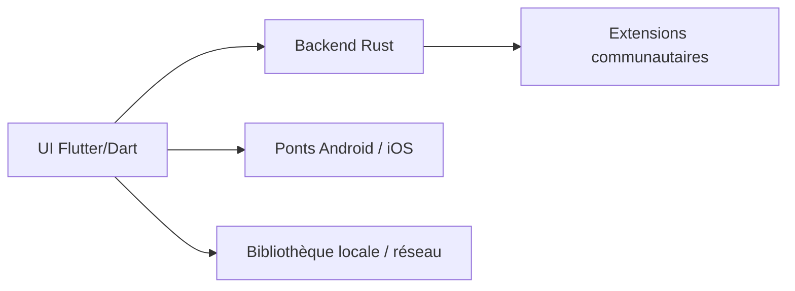

# zarzet/SpotiFLAC-Mobile

> Mobile app (display name Mornye) to download, organize and play your music, with extensions.

## The problem
A music library player and manager that downloads through extensions and plays in high quality.

## What it actually does
Android and iOS player with bit-perfect USB playback, equalizer, ReplayGain, synced lyrics, local library, network sources (SMB, WebDAV, Subsonic). Downloads go through extensions from community repositories (`registry.json`). Flutter/Dart interface, Rust backend, platform bridges.

## How it is wired


## Trying it
```
Source AltStore/SideStore :
https://raw.githubusercontent.com/mornyeapp/Mornye/refs/heads/main/apps.json
```

## Cost and gotchas
Free. Availability depends on the country (VPN suggested by the FAQ). The maintainer states that the repository hosts no protected content.

## What it is not
Not affiliated with streaming services. Not a data project. Legal responsibility for usage is left to the user (see the Disclaimer section).

## Alternatives
No alternative named.

## For you
Ignore: consumer app unrelated to your field, with a compliance risk on downloads.
