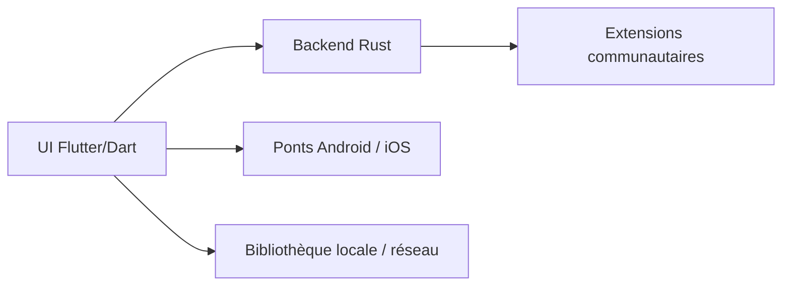

# zarzet/SpotiFLAC-Mobile

> Application mobile (nom d'affichage Mornye) pour télécharger, organiser et lire sa musique, avec extensions.

## Le problème
Un lecteur et gestionnaire de bibliothèque musicale qui télécharge via des extensions et lit en haute qualité.

## Ce que ça fait vraiment
Lecteur Android et iOS avec lecture USB bit-perfect, égaliseur, ReplayGain, paroles synchronisées, bibliothèque locale, sources réseau (SMB, WebDAV, Subsonic). Les téléchargements passent par des extensions de dépôts communautaires (`registry.json`). Interface Flutter/Dart, backend Rust, ponts plateformes.

## Comment c'est branché


## Essayer
```
Source AltStore/SideStore :
https://raw.githubusercontent.com/mornyeapp/Mornye/refs/heads/main/apps.json
```

## Coût et pièges
Gratuit. Disponibilité selon pays (VPN suggéré par la FAQ). Le mainteneur précise que le dépôt n'héberge aucun contenu protégé.

## Ce que ce n'est pas
Pas affilié aux services de streaming. Pas un projet data. Responsabilité légale des usages laissée à l'utilisateur (voir la section Disclaimer).

## Alternatives
Aucune alternative nommée.

## Pour toi
Ignorer : application grand public sans rapport avec ton métier, avec un risque de conformité sur les téléchargements.

