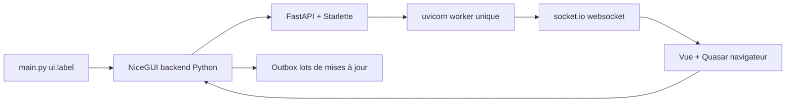

# zauberzeug/nicegui

> Python UI framework that renders in the browser, from a button to a 3D scene.

## The problem
Putting an interface on a Python script — tuning an algorithm, driving a robot —
otherwise means writing a separate front end or putting up with the magic state
management of other frameworks.

## What it actually does
Standard elements (label, button, checkbox, slider, input, upload), grouping into
rows, columns, cards and dialogs, Markdown and general HTML. High-level
elements: charts, 3D scenes, virtual joysticks, image annotation and overlay,
tables, collapsible trees, video and audio. Built-in timer down to 10 ms,
data binding and refreshable functions, notifications and menus, shared
or per-user pages, per-user persistence, custom routes, global
keyboard capture, theming with primary/secondary/accent colors, Tailwind
autocompletion, pytest-based testing framework. Implicit reload on every
code change, server mode or native desktop-window mode, works in
Jupyter.

## How it is wired


## Trying it
```bash
python3 -m pip install nicegui
python3 main.py
docker run -p 8080:8080 zauberzeug/nicegui
```

## Cost and gotchas
Free, no account to create. A single uvicorn worker: all the logic lives
in one asynchronous process, so a blocking task freezes the UI for all
clients. Communication goes through a websocket that stays open permanently after the page
has loaded.

## What it is not
Not a general-purpose web framework nor a replacement for an application front end: it is made
for micro-applications, dashboards, robotics, home automation. No multi-process
scalability by design.

## Alternatives
- Streamlit: simpler, but "too much magic" around state according to the authors.
- JustPy: the approach that inspired NiceGUI, judged too close to HTML.

## For you
The right tool when you need an interface around a model or a script without
leaving Python. The `nicegui/llms.md` file shipped with the package helps an agent.
