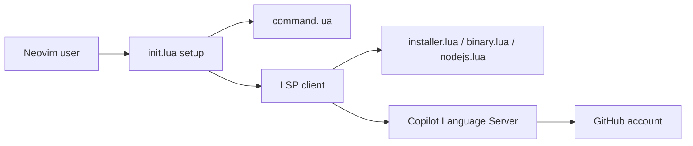

# zbirenbaum/copilot.lua

> Neovim plugin in Lua that plugs in GitHub Copilot, an alternative to copilot.vim, for Neovim users.

## The problem
copilot.vim makes the computer overheat and its large blocks of ghost text get in the way of other completions.

## What it actually does
Launches the Copilot Language Server (a native binary downloaded and verified by SHA-256, or Node.js 22+), shows suggestions as ghost text or in a panel, handles authentication and offers an experimental NES (next edit suggestion) mode via copilot-lsp. Provides an API for integrations (cmp, blink, lualine).

## How it is wired


## Trying it
```lua
use { "zbirenbaum/copilot.lua",
  cmd = "Copilot",
  event = "InsertEnter",
  config = function()
    require("copilot").setup({})
  end,
}
```
Then `:Copilot auth`.

## Cost and gotchas
A GitHub account with Copilot access (the subscription is not described here). First launch: a 75 to 110 MB download. Neovim 0.11+. The code of your suggestions is sent to the Copilot service.

## What it is not
Not an autonomous assistant nor a chat: only code suggestions. Not a free alternative: it depends on the Copilot service.

## Alternatives
`github/copilot.vim`: the official version, replaced here by Lua.

## For you
Keep an eye on it: useful only if you code in Neovim and already have Copilot; the cost of depending on a SaaS remains.
