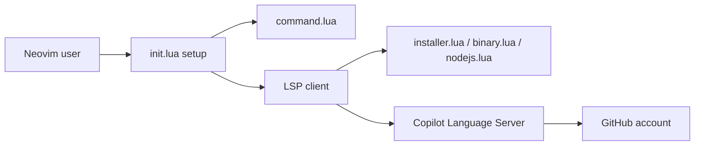

# zbirenbaum/copilot.lua

> Plugin Neovim en Lua branchant GitHub Copilot, alternative à copilot.vim, pour utilisateurs de Neovim.

## Le problème
copilot.vim fait surchauffer l'ordinateur et ses grands blocs de texte fantôme gênent les autres complétions.

## Ce que ça fait vraiment
Lance le Copilot Language Server (binaire natif téléchargé et vérifié par SHA-256, ou Node.js 22+), affiche des suggestions en texte fantôme ou dans un panneau, gère l'authentification et propose un mode NES (next edit suggestion) expérimental via copilot-lsp. Fournit une API pour des intégrations (cmp, blink, lualine).

## Comment c'est branché


## Essayer
```lua
use { "zbirenbaum/copilot.lua",
  cmd = "Copilot",
  event = "InsertEnter",
  config = function()
    require("copilot").setup({})
  end,
}
```
Puis `:Copilot auth`.

## Coût et pièges
Compte GitHub avec accès Copilot (l'abonnement n'est pas décrit ici). Premier lancement : téléchargement de 75 à 110 Mo. Neovim 0.11+. Le code des suggestions part au service Copilot.

## Ce que ce n'est pas
Pas un assistant autonome ni un chat : seulement des suggestions de code. Pas une alternative libre : dépend du service Copilot.

## Alternatives
`github/copilot.vim` : la version officielle, remplacée ici par du Lua.

## Pour toi
Surveiller : utile seulement si tu codes sous Neovim et as déjà Copilot ; le coût de dépendance à un SaaS reste.

