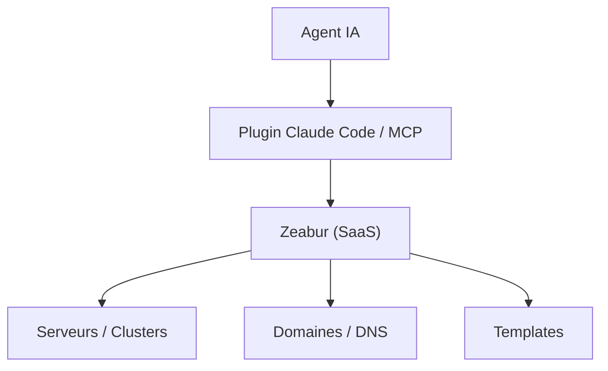

# zeabur/zeabur

> Hosting platform that can be driven in natural language by an AI agent, for developers without DevOps expertise.

## The problem
Deploying, attaching a domain and a database, and diagnosing an outage requires DevOps skills and a lot of manual work.

## What it actually does
The repository contains only a README presenting the Zeabur platform. It describes a Claude Code plugin, an MCP server and a VS Code/Cursor extension that drive deployment. The platform detects the language without a Dockerfile, and manages servers (rented or your own), Kubernetes clusters, domains, e-mail (API on AWS SES) and templates in YAML. The code of the platform itself is not described.

## How it is wired
Simplified diagram based on the sheet, no diagram provided.



## Trying it
```bash
claude plugin marketplace add zeabur/zeabur-claude-plugin
claude plugin install zeabur@zeabur
npx zeabur
```

## Cost and gotchas
A Zeabur account is required; servers are billed monthly at a flat rate, the price list is not in the README. Total dependence on a third-party hosted service.

## What it is not
Not an open-source tool to self-host: the repository is a showcase. Not a guarantee of portability, your deployments live at Zeabur.

## Alternatives
No alternative named in the README.

## For you
Worth watching: handy for putting an AI prototype online via an agent, but this repository brings no code to audit and creates lock-in to a SaaS.
