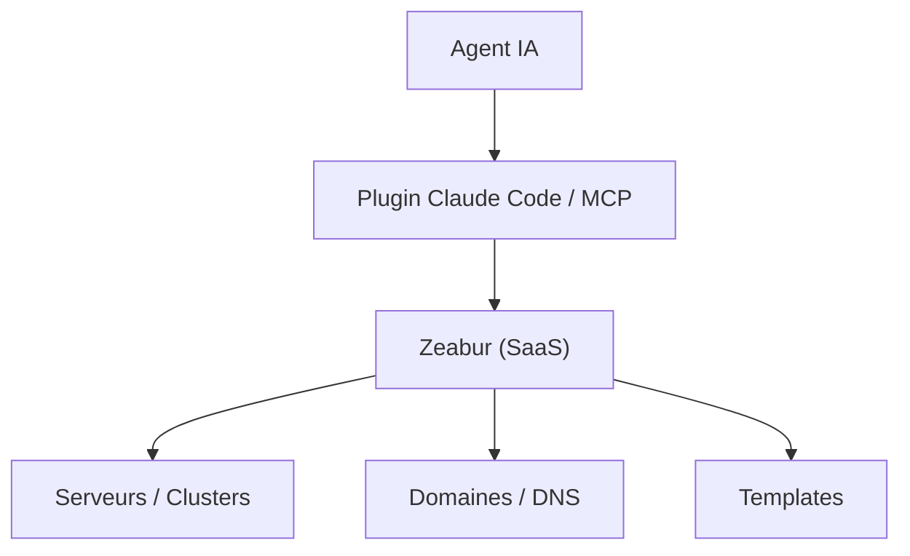

# zeabur/zeabur

> Plateforme d'hébergement pilotable en langage naturel par un agent IA, pour développeurs sans expertise DevOps.

## Le problème
Déployer, brancher un domaine, une base et diagnostiquer une panne demande des compétences DevOps et beaucoup de manipulations manuelles.

## Ce que ça fait vraiment
Le dépôt ne contient qu'un README de présentation de la plateforme Zeabur. Il décrit un plugin Claude Code, un serveur MCP et une extension VS Code/Cursor qui pilotent le déploiement. La plateforme détecte le langage sans Dockerfile, gère serveurs (loués ou les vôtres), clusters Kubernetes, domaines, e-mail (API sur AWS SES) et templates en YAML. Le code de la plateforme elle-même n'est pas décrit.

## Comment c'est branché
Schéma simplifié d'après la fiche, sans diagramme fourni.



## Essayer
```bash
claude plugin marketplace add zeabur/zeabur-claude-plugin
claude plugin install zeabur@zeabur
npx zeabur
```

## Coût et pièges
Compte Zeabur requis ; les serveurs sont facturés au mois à tarif fixe, la grille tarifaire n'est pas dans le README. Dépendance totale à un service hébergé tiers.

## Ce que ce n'est pas
Ce n'est pas un outil open source à auto-héberger : le dépôt est une vitrine. Ce n'est pas une garantie de portabilité, vos déploiements vivent chez Zeabur.

## Alternatives
Aucune alternative nommée dans le README.

## Pour toi
À surveiller : pratique pour mettre en ligne un prototype IA via un agent, mais ce dépôt n'apporte pas de code à auditer et crée un verrouillage sur un SaaS.

