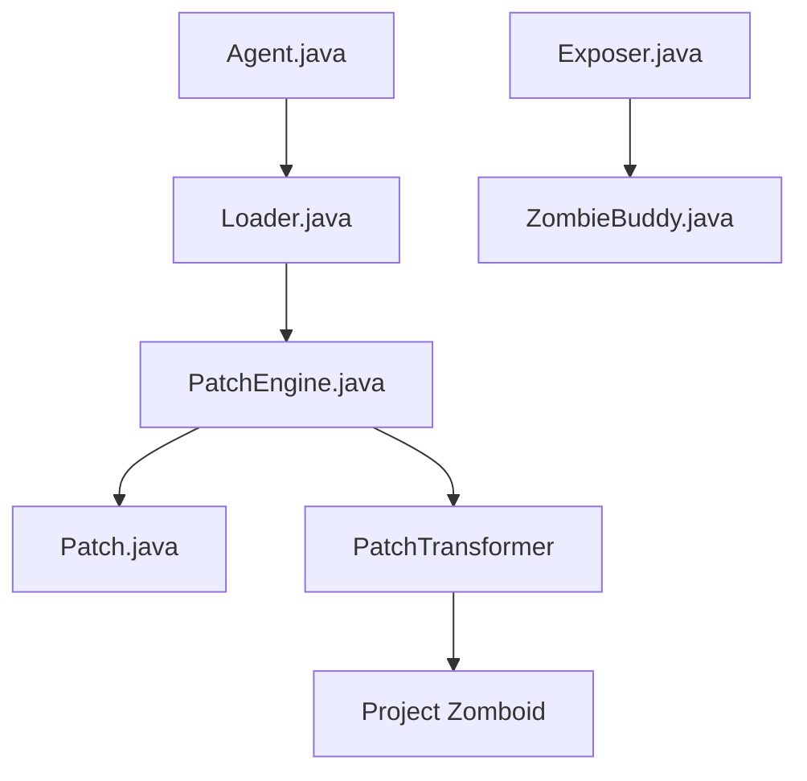

# zed-0xff/ZombieBuddy

> Java agent that lets Project Zomboid modders patch the game's classes at runtime.

## The problem
Java mods for Project Zomboid required bundling `.class` files and manually replacing game files.

## What it actually does
A `-javaagent` agent loads Java mods, discovers their patches declared via `@Patch` annotations (through ByteBuddy) and transforms the game's classes on the fly. It also exposes Java classes to Lua, handles mod approval and author signing. An experimental HTTP module runs Lua.

## How it is wired


## Trying it
```bash
# Windows : lancer ZombieBuddyInstaller.exe
# macOS/Linux : copier ZombieBuddy.jar dans le dossier du jeu puis ajouter aux options de lancement
-javaagent:ZombieBuddy.jar --
```

## Cost and gotchas
Requires Project Zomboid Build 42+ and Java 25 (Gradle to build mods). Enabled Java mods have unrestricted access to the system: the README says so itself.

## What it is not
Not a general-purpose Java instrumentation tool: it targets a single game. No sandbox for mods.

## Alternatives
No alternative named in the README.

## For you
Ignore: reserved for Project Zomboid modding, no data/AI/MLOps use.
