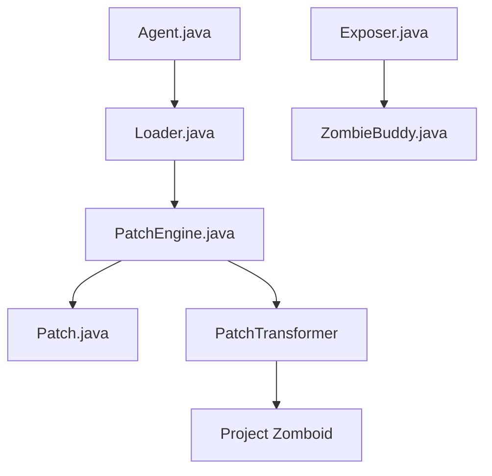

# zed-0xff/ZombieBuddy

> Agent Java qui permet aux moddeurs de Project Zomboid de patcher les classes du jeu à l'exécution.

## Le problème
Les mods Java de Project Zomboid exigeaient d'embarquer des `.class` et de remplacer à la main des fichiers du jeu.

## Ce que ça fait vraiment
Un agent `-javaagent` charge les mods Java, découvre leurs patchs déclarés par annotations `@Patch` (via ByteBuddy) et transforme les classes du jeu à chaud. Il expose aussi des classes Java à Lua, gère une approbation des mods et la signature des auteurs. Un module HTTP expérimental exécute du Lua.

## Comment c'est branché


## Essayer
```bash
# Windows : lancer ZombieBuddyInstaller.exe
# macOS/Linux : copier ZombieBuddy.jar dans le dossier du jeu puis ajouter aux options de lancement
-javaagent:ZombieBuddy.jar --
```

## Coût et pièges
Exige Project Zomboid Build 42+ et Java 25 (Gradle pour compiler des mods). Les mods Java activés ont un accès illimité au système : le README le dit lui-même.

## Ce que ce n'est pas
Pas un outil général d'instrumentation Java : il vise un seul jeu. Pas de sandbox pour les mods.

## Alternatives
Aucune alternative nommée dans le README.

## Pour toi
Ignorer : réservé au modding de Project Zomboid, aucun usage data/IA/MLOps.

