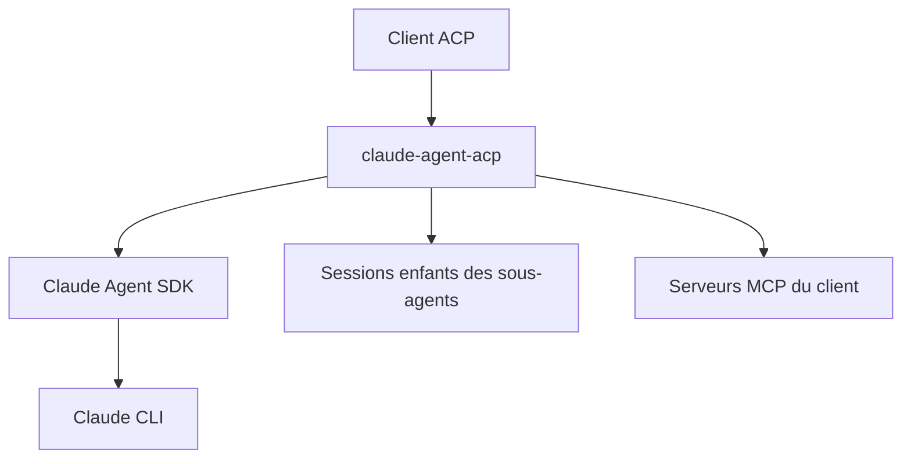

# zed-industries/claude-agent-acp

> Adapter that exposes the Claude Agent SDK to editors compatible with the ACP protocol.

## The problem
An editor that speaks ACP cannot drive Claude Code directly, because each one has its own protocol.

## What it actually does
The adapter implements an ACP agent on top of the Claude Agent SDK. It supports context mentions, images, tool calls with permission requests, task lists, terminals, slash commands and the client's MCP servers. Sub-agents can become child sessions. It also serves a draft ACP v2 version, and extensions for JetBrains AIR.

## How it is wired
Simplified diagram based on the sheet, no diagram provided.



## Trying it
```bash
npm install @agentclientprotocol/claude-agent-acp@preview
npm run build:binary
npm run smoke:binary
```

## Cost and gotchas
A Claude login is required (account and usage at your expense); the full smoke test requires a Claude session. Standalone binaries need Bun to be built, and libgcc and libstdc++ on Alpine. The `preview` channel publishes on every push to main.

## What it is not
It is not an autonomous agent: it is a gateway to Claude Code. ACP v2 is a draft that may still change, and the AIR extensions remain on v1.

## Alternatives
No alternative is named in the README.

## For you
Adopt it if your editor speaks ACP and you already use Claude: it is the official route, otherwise irrelevant.
