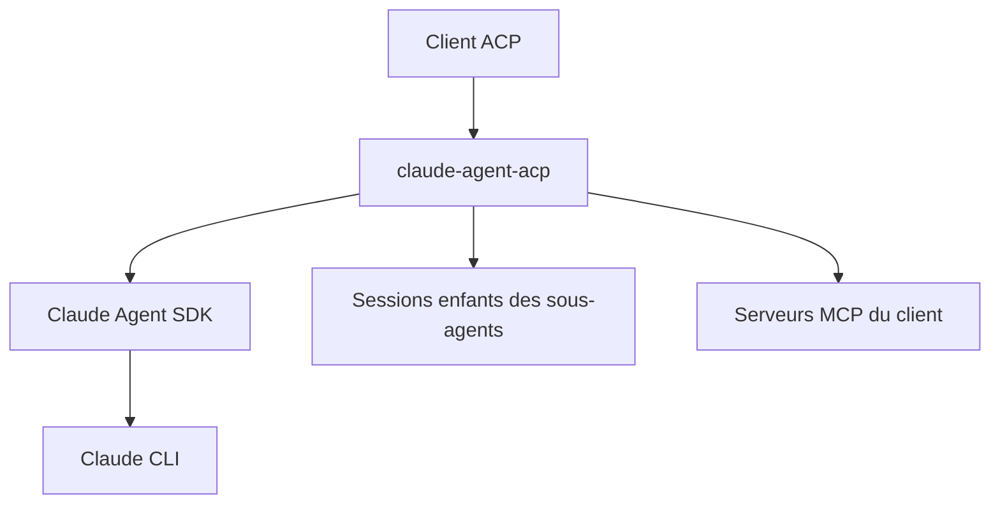

# zed-industries/claude-agent-acp

> Adaptateur qui expose le SDK Claude Agent aux éditeurs compatibles avec le protocole ACP.

## Le problème
Un éditeur qui parle ACP ne peut pas piloter directement Claude Code, car chacun a son propre protocole.

## Ce que ça fait vraiment
L'adaptateur implémente un agent ACP au-dessus du SDK Claude Agent. Il prend en charge les mentions de contexte, les images, les appels d'outils avec demandes de permission, les listes de tâches, les terminaux, les commandes slash et les serveurs MCP du client. Les sous-agents peuvent devenir des sessions enfants. Il sert aussi une version draft ACP v2, et des extensions pour JetBrains AIR.

## Comment c'est branché
Schéma simplifié d'après la fiche, sans diagramme fourni.



## Essayer
```bash
npm install @agentclientprotocol/claude-agent-acp@preview
npm run build:binary
npm run smoke:binary
```

## Coût et pièges
Il faut une connexion Claude (compte et usage à ta charge) ; le smoke test complet exige une session Claude. Les binaires autonomes demandent Bun pour être construits, et libgcc et libstdc++ sur Alpine. Le canal `preview` publie à chaque push sur main.

## Ce que ce n'est pas
Ce n'est pas un agent autonome : c'est une passerelle vers Claude Code. ACP v2 est un draft qui peut encore changer, et les extensions AIR restent en v1.

## Alternatives
Aucune alternative n'est nommée dans le README.

## Pour toi
À adopter si ton éditeur parle ACP et que tu utilises déjà Claude : c'est la voie officielle, sinon sans objet.

