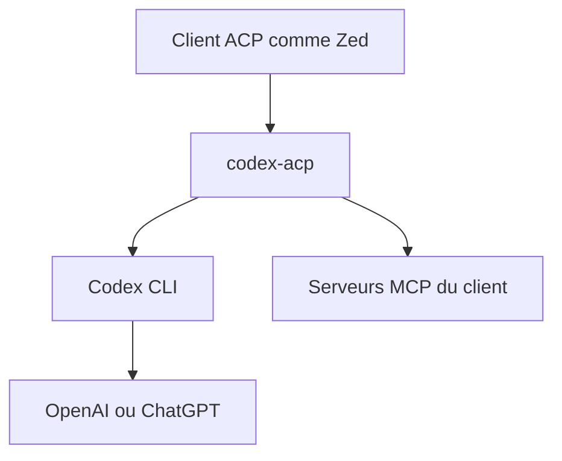

# zed-industries/codex-acp

> ACP adapter that lets you use Codex from Zed and other compatible clients.

## The problem
Codex CLI does not speak the ACP protocol, so compatible editors cannot drive it.

## What it actually does
- Wraps Codex CLI as an ACP agent.
- Supports context mentions, images, tool calls with permission requests, review of changes, TODO lists.
- Commands `/review`, `/review-branch`, `/review-commit`, `/init`, `/compact`, `/logout` and the client's MCP servers.
- Authentication via ChatGPT subscription, `CODEX_API_KEY` or `OPENAI_API_KEY`.

## How it is wired
Simplified diagram based on the fiche, no diagram provided.


## Trying it
```bash
OPENAI_API_KEY=sk-... codex-acp
npx @zed-industries/codex-acp
```

## Cost and gotchas
An OpenAI key or a paid ChatGPT subscription is required, the latter not working in remote projects. Development has moved to agentclientprotocol/codex-acp.

## What it is not
Not the repository to use for new installations: the README points to `@agentclientprotocol/codex-acp`.

## Alternatives
- agentclientprotocol/codex-acp: the new adapter, built on the Codex App Server.

## For you
Ignore: archived; if you want Codex in Zed, switch to the repository that replaced it.
