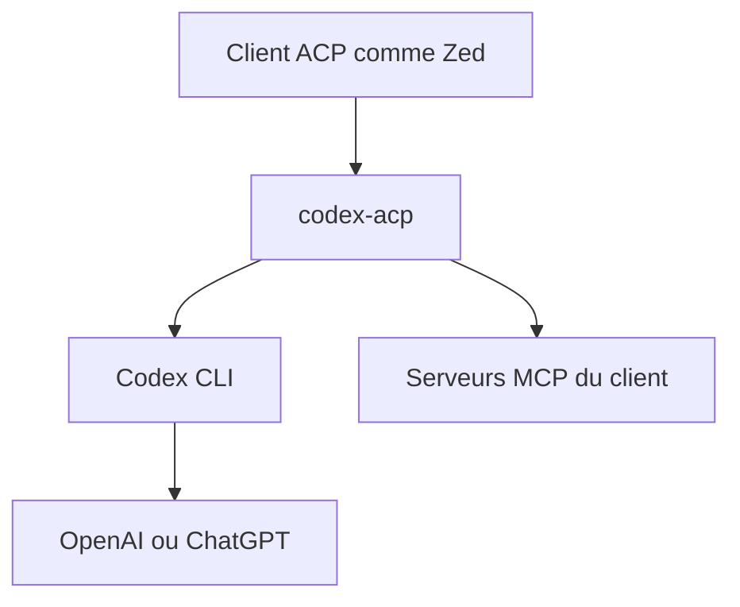

# zed-industries/codex-acp

> Adaptateur ACP qui permet d'utiliser Codex depuis Zed et d'autres clients compatibles.

## Le problème
Codex CLI ne parle pas le protocole ACP, donc les éditeurs compatibles ne peuvent pas le piloter.

## Ce que ça fait vraiment
- Enveloppe Codex CLI en agent ACP.
- Supporte mentions de contexte, images, appels d'outils avec demande de permission, revue des modifications, listes TODO.
- Commandes `/review`, `/review-branch`, `/review-commit`, `/init`, `/compact`, `/logout` et serveurs MCP du client.
- Authentification par abonnement ChatGPT, `CODEX_API_KEY` ou `OPENAI_API_KEY`.

## Comment c'est branché
Schéma simplifié d'après la fiche, sans diagramme fourni.


## Essayer
```bash
OPENAI_API_KEY=sk-... codex-acp
npx @zed-industries/codex-acp
```

## Coût et pièges
Clé OpenAI ou abonnement ChatGPT payant requis, ce dernier ne marchant pas dans les projets distants. Le développement a déménagé vers agentclientprotocol/codex-acp.

## Ce que ce n'est pas
Pas le dépôt à utiliser pour de nouvelles installations : le README renvoie à `@agentclientprotocol/codex-acp`.

## Alternatives
- agentclientprotocol/codex-acp : le nouvel adaptateur, bâti sur le Codex App Server.

## Pour toi
À ignorer : archivé ; si tu veux Codex dans Zed, passe au dépôt qui l'a remplacé.

