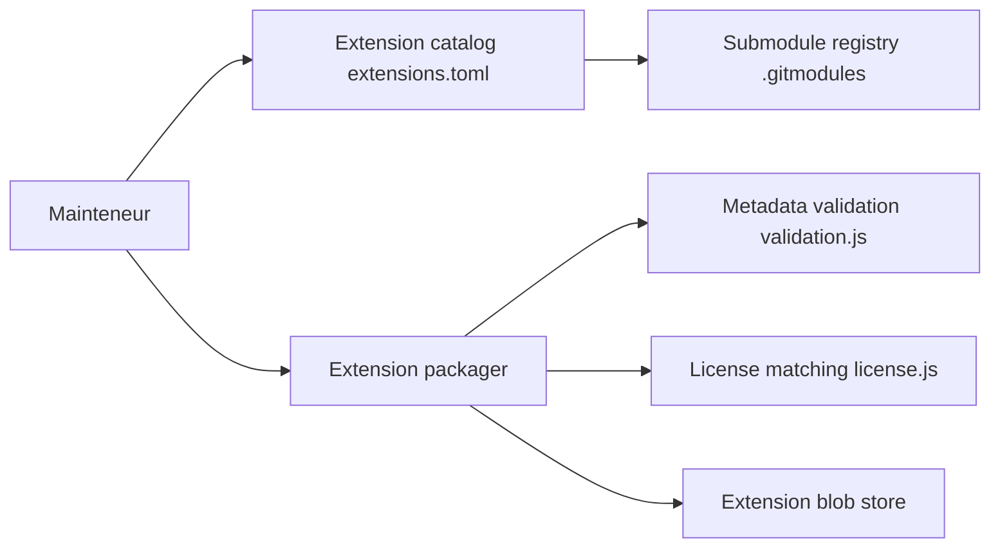

# zed-industries/extensions

> Central repository of the Zed editor's extension catalog, for extension authors.

## The problem
Zed needs a single place to publish, validate and distribute its extensions.

## What it actually does
An `extensions.toml` catalog references each extension as a Git submodule. Scripts validate metadata, check licenses, package modified extensions, and can publish the packages to object storage; others remove an extension or sort the catalog. The submodules themselves are not described here.

## How it is wired

## Trying it
No documented command.

## Cost and gotchas
Free. Every submission is reviewed and may be rejected; read the Publishing Guidelines before submitting. An extension tagged `needs infrastructure` cannot be developed.

## What it is not
Not an extension or a tool to install: it is the publishing infrastructure. No license for the repository itself; licenses are those of each extension. Very short README: little material to read.

## Alternatives
No alternative named in the README.

## For you
Ignore: useful only if you write a Zed extension; the extensions page in the editor is enough to use them.
