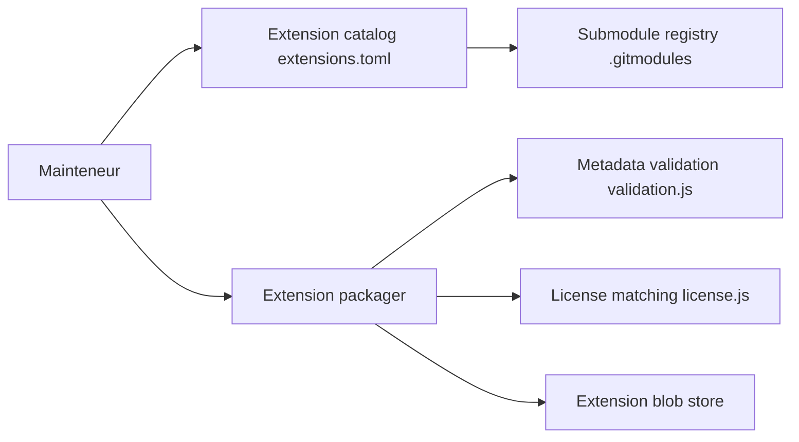

# zed-industries/extensions

> Dépôt central du catalogue des extensions de l'éditeur Zed, pour auteurs d'extensions.

## Le problème
Zed a besoin d'un point unique où publier, valider et distribuer ses extensions.

## Ce que ça fait vraiment
Un catalogue `extensions.toml` référence chaque extension comme sous-module Git. Des scripts valident les métadonnées, vérifient les licences, empaquettent les extensions modifiées, et peuvent publier les paquets dans un stockage objet ; d'autres suppriment une extension ou trient le catalogue. Les sous-modules eux-mêmes ne sont pas décrits ici.

## Comment c'est branché

## Essayer
Aucune commande documentée.

## Coût et pièges
Gratuit. Toute soumission est examinée et peut être refusée ; il faut lire les Publishing Guidelines avant de soumettre. Une extension taguée `needs infrastructure` ne peut pas être développée.

## Ce que ce n'est pas
Pas une extension ni un outil à installer : c'est l'infrastructure de publication. Pas de licence pour le dépôt lui-même ; les licences sont celles de chaque extension. README très court : peu de matière à lire.

## Alternatives
Aucune alternative nommée dans le README.

## Pour toi
À ignorer : utile seulement si tu écris une extension Zed ; la page des extensions dans l'éditeur suffit pour les utiliser.

