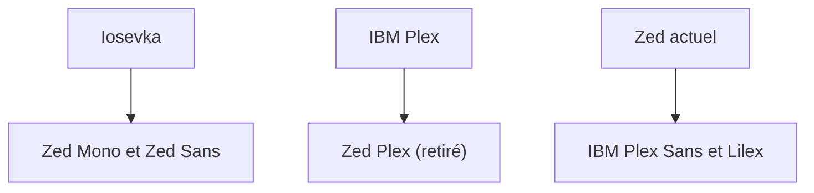

# zed-industries/zed-fonts

> Archive of the Zed editor's former fonts, now replaced by IBM Plex Sans and Lilex.

## The problem
Finding the custom fonts the Zed editor used before it switched.

## What it actually does
The README is very short: Zed now uses IBM Plex Sans and Lilex. Zed Plex Mono was removed because of the open font license; before that there were Zed Mono and Zed Sans, builds of Iosevka under SIL OFL 1.1.

## How it is wired
Simplified diagram based on the sheet, no diagram provided.

## Trying it
No documented command.

## Cost and gotchas
Free. Archived repository, no license declared on GitHub, last push in August 2025.

## What it is not
Not an active tool: an archive of outdated fonts.

## Alternatives
Zed's current fonts, IBM Plex Sans and Lilex.

## For you
Ignore: an archive of editor fonts unrelated to data or AI.
