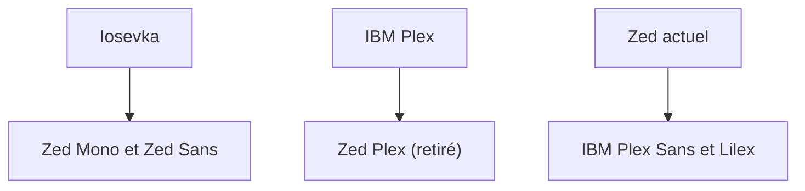

# zed-industries/zed-fonts

> Archive des anciennes polices de l'éditeur Zed, aujourd'hui remplacées par IBM Plex Sans et Lilex.

## Le problème
Retrouver les polices personnalisées que l'éditeur Zed utilisait avant de changer.

## Ce que ça fait vraiment
Le README est très court : Zed utilise désormais IBM Plex Sans et Lilex. Zed Plex Mono a été retiré à cause de la licence de police ouverte ; avant cela existaient Zed Mono et Zed Sans, des builds d'Iosevka sous SIL OFL 1.1.

## Comment c'est branché
Schéma simplifié d'après la fiche, sans diagramme fourni.

## Essayer
Aucune commande documentée.

## Coût et pièges
Gratuit. Dépôt archivé, sans licence déclarée sur GitHub, dernier push en août 2025.

## Ce que ce n'est pas
Pas un outil actif : une archive de polices dépassées.

## Alternatives
Les polices actuelles de Zed, IBM Plex Sans et Lilex.

## Pour toi
À ignorer : archive de polices d'éditeur sans rapport avec la data ou l'IA.

