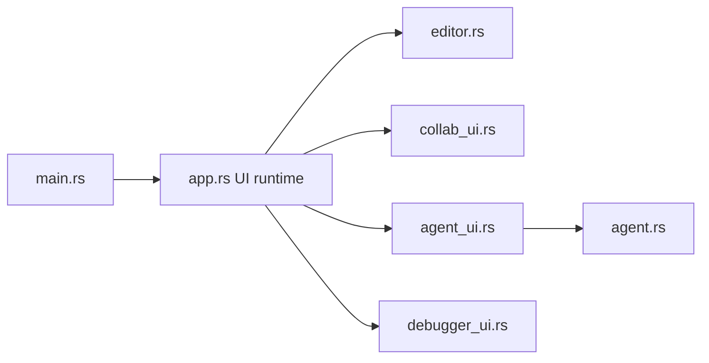

# zed-industries/zed

> Multiplayer code editor, speed-oriented, by the creators of Atom and Tree-sitter.

## The problem
Classic editors are slow and handle real-time collaboration poorly.

## What it actually does
Editor with workspace, multiplayer collaboration (channels), AI assistance (agent, tools, models via cloud), debugger (DAP protocol), extensions and context servers. Workspace history is persistent. Installs on macOS, Linux and Windows; the web is not available. The README specifies that the license is mostly GPL-3.0-or-later with some Apache-2.0 parts.

## How it is wired


## Trying it
```bash
# aucune commande dans le README : téléchargement ou gestionnaire de paquets, compilation selon les guides par système
```

## Cost and gotchas
Free. AI goes through cloud models; the terms are not detailed here. The license is not identified by GitHub, but the README states GPL-3.0-or-later.

## What it is not
Not a VS Code compatible with its extensions. Not available in the browser.

## Alternatives
No alternative named in the README.

## For you
Worth watching: try it as a fast editor with a built-in agent, without making it a team standard until the GPL license is validated.
