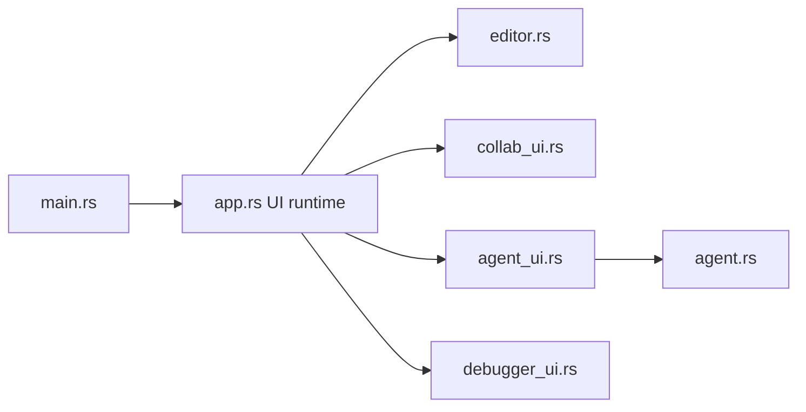

# zed-industries/zed

> Éditeur de code multijoueur, orienté vitesse, par les créateurs d'Atom et de Tree-sitter.

## Le problème
Les éditeurs classiques sont lents et gèrent mal la collaboration en temps réel.

## Ce que ça fait vraiment
Éditeur avec espace de travail, collaboration multijoueur (canaux), assistance IA (agent, outils, modèles via cloud), débogueur (protocole DAP), extensions et serveurs de contexte. L'historique de l'espace de travail est persistant. Installation sur macOS, Linux et Windows ; le web n'est pas disponible. Le README précise que la licence est surtout GPL-3.0-or-later avec des parties Apache-2.0.

## Comment c'est branché


## Essayer
```bash
# aucune commande dans le README : téléchargement ou gestionnaire de paquets, compilation selon les guides par système
```

## Coût et pièges
Gratuit. L'IA passe par des modèles cloud ; les conditions ne sont pas détaillées ici. La licence n'est pas identifiée par GitHub, mais le README indique GPL-3.0-or-later.

## Ce que ce n'est pas
Pas un VS Code compatible avec ses extensions. Pas disponible dans le navigateur.

## Alternatives
Aucune alternative nommée dans le README.

## Pour toi
À surveiller : essaie-le comme éditeur rapide avec agent intégré, sans en faire un standard d'équipe tant que la licence GPL n'est pas validée.

