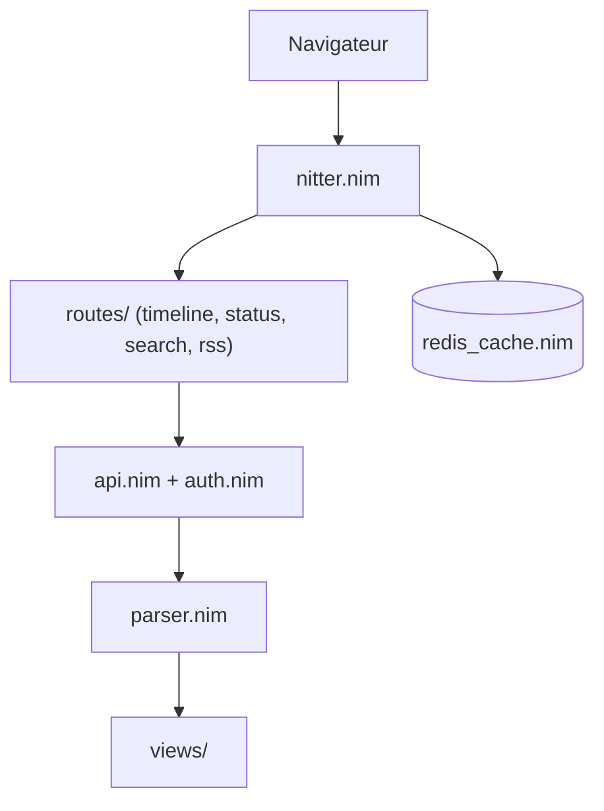

# zedeus/nitter

> Alternative, self-hosted, JavaScript-free Twitter front end, for reading Twitter without tracking.

## The problem
Twitter requires JavaScript and sign-up, and tracks you by IP and browser fingerprint.

## What it actually does
A Nim server renders HTML and RSS on the server side; the browser only talks to Nitter, which queries Twitter's unofficial API. Redis or Valkey serves as a cache. Configured Twitter sessions are required (a sessions.jsonl file is cited for docker-compose).

## How it is wired


## Trying it
```bash
docker run -v $(pwd)/nitter.conf:/src/nitter.conf -d --network host zedeus/nitter:latest
```

## Cost and gotchas
Free, but Redis/Valkey and a reverse proxy are on you. Total dependence on Twitter's unofficial API. The README announces cease-and-desist letters from X Corp. (August 2026) demanding the project be shut down. Repository marked as archived.

## What it is not
Not an official Twitter service. Not durable: legal threat and unstable API.

## Alternatives
No alternative named in the README (inspired by Invidious).

## For you
Ignore: archived, legally threatened and AGPL, with no interest for data / AI / MLOps work.
