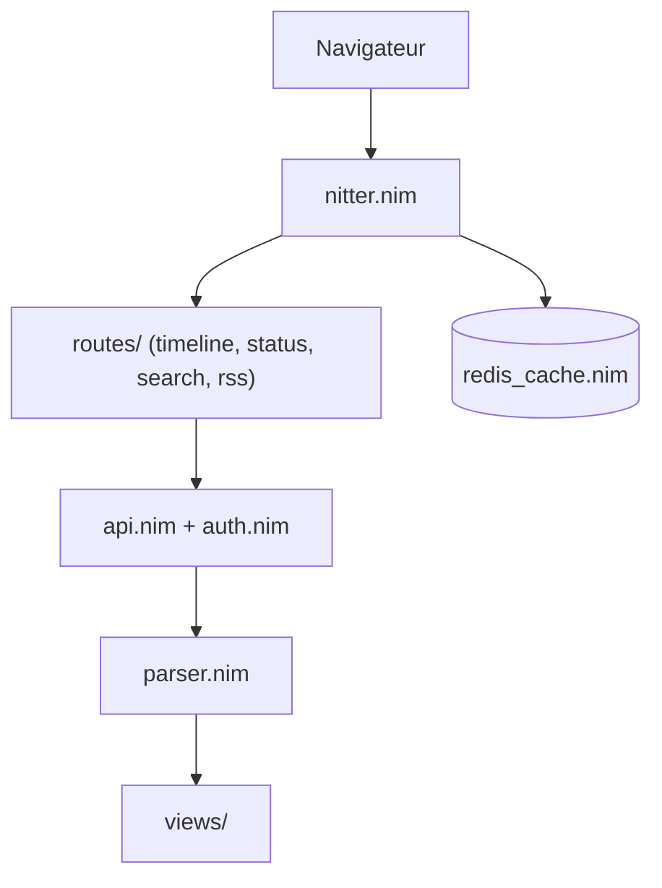

# zedeus/nitter

> Front-end Twitter alternatif sans JavaScript, hébergé soi-même, pour lire Twitter sans pistage.

## Le problème
Twitter impose JavaScript et une inscription, et te piste par IP et empreinte de navigateur.

## Ce que ça fait vraiment
Un serveur Nim rend côté serveur HTML et RSS ; le navigateur ne parle qu'à Nitter, qui interroge l'API non officielle de Twitter. Redis ou Valkey sert de cache. Il faut des sessions Twitter configurées (fichier sessions.jsonl cité pour docker-compose).

## Comment c'est branché


## Essayer
```bash
docker run -v $(pwd)/nitter.conf:/src/nitter.conf -d --network host zedeus/nitter:latest
```

## Coût et pièges
Gratuit, mais Redis/Valkey et un reverse proxy sont à ta charge. Dépendance totale à l'API non officielle de Twitter. Le README annonce des mises en demeure de X Corp. (août 2026) exigeant la fermeture du projet. Dépôt marqué archivé.

## Ce que ce n'est pas
Pas un service Twitter officiel. Pas durable : menace juridique et API instable.

## Alternatives
Aucune alternative nommée dans le README (inspiré d'Invidious).

## Pour toi
Ignorer : archivé, menacé juridiquement et AGPL, sans intérêt pour un travail data / IA / MLOps.

