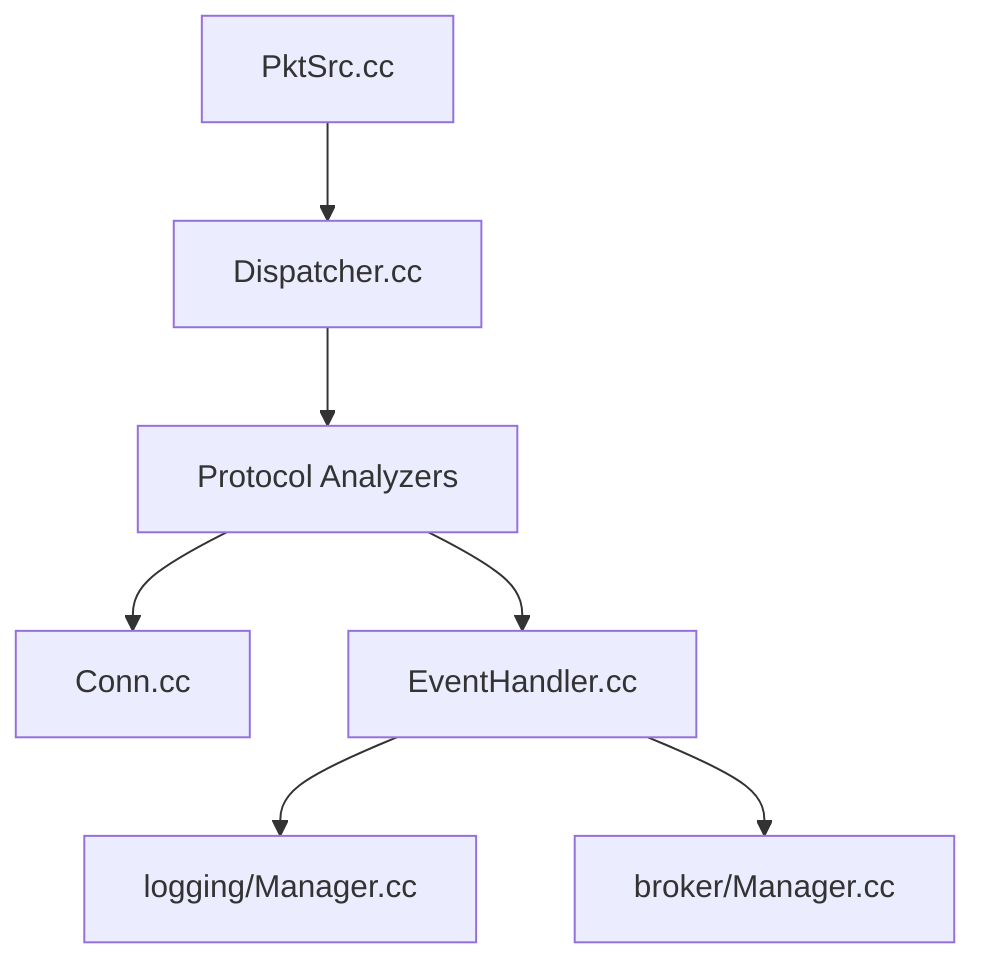

# zeek/zeek

> Network security monitor: analyzes traffic, protocol by protocol, with policy scripts.

## The problem
Seeing what actually happens on a network, at the application level, and detecting behaviors without being limited to signatures.

## What it actually does
Captures or replays traffic, runs it through protocol analyzers, keeps connection and file state, and raises events handled by scripts in a dedicated language. Outputs: logs, events distributed across a cluster (Broker) and telemetry metrics. Plugins and Spicy analyzers optional.

## How it is wired


## Trying it
```bash
git clone --recursive https://github.com/zeek/zeek
./configure && make && sudo make install
zeek hello.zeek
```

## Cost and gotchas
Free. Compiled from source with all dependencies (not listed in the README; see the website). On high-throughput networks, deployment needs tuning.

## What it is not
Not an out-of-the-box signature-based IDS: it is a scripting framework. The README states a BSD license, but GitHub does not identify it.

## Alternatives
No alternative named in the README.

## For you
Worth watching: the reference for producing usable network logs for threat detection or datasets; outside security, little use.
