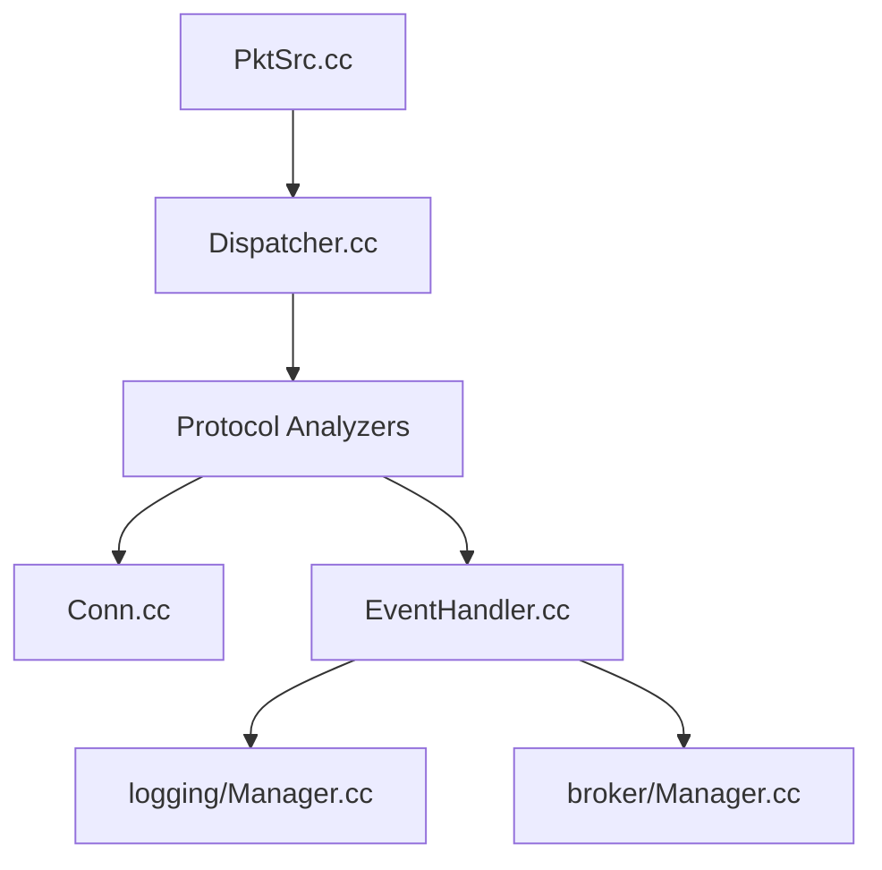

# zeek/zeek

> Moniteur de sécurité réseau : analyse le trafic, protocole par protocole, avec des scripts de politique.

## Le problème
Voir ce qui se passe réellement sur un réseau, au niveau applicatif, et détecter des comportements sans se limiter à des signatures.

## Ce que ça fait vraiment
Capture ou rejoue du trafic, le fait passer par des analyseurs de protocoles, garde l'état des connexions et fichiers, et lève des événements traités par des scripts dans un langage dédié. Résultats : journaux, événements distribués en cluster (Broker) et métriques de télémétrie. Plugins et analyseurs Spicy en option.

## Comment c'est branché


## Essayer
```bash
git clone --recursive https://github.com/zeek/zeek
./configure && make && sudo make install
zeek hello.zeek
```

## Coût et pièges
Gratuit. Compilation depuis les sources avec toutes les dépendances (non listées dans le README ; voir le site). Sur des réseaux à fort débit, le déploiement demande du réglage.

## Ce que ce n'est pas
Pas un IDS à signatures prêt à l'emploi : c'est un cadre de scripts. Le README annonce une licence BSD, mais GitHub ne l'identifie pas.

## Alternatives
Aucune alternative nommée dans le README.

## Pour toi
À surveiller : référence pour produire des journaux réseau exploitables en détection de menaces ou en jeux de données ; hors sécurité, peu d'usage.

