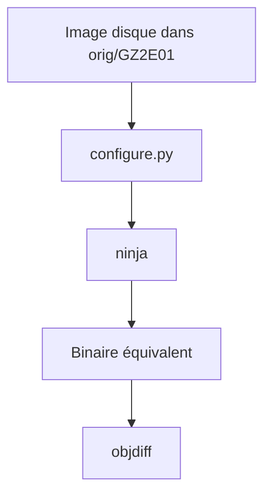

# zeldaret/tp

> Ongoing decompilation of Zelda: Twilight Princess, to recover source code equivalent to the original.

## The problem
The game's original source code is not available, which prevents studying it, fixing it or adapting it.

## What it actually does
Rebuilds C/C++ code that, when recompiled, gives back a binary identical to the original. The code for the GameCube versions is fully equivalent, but not all translation units are linked yet; the debug version and the Wii versions are being aligned. A single codebase, with conditional compilation. The repository contains no game assets or assembly.

## How it is wired
Simplified diagram based on the sheet, no diagram provided.


## Trying it
```bash
git clone https://github.com/zeldaret/tp.git
python configure.py
ninja
```

## Cost and gotchas
Free, but you must own a copy of the game (disc image in `orig/GZ2E01`). Requires git, ninja and Python 3; on Windows, prefer native tools over WSL.

## What it is not
Not a PC port and it will not produce one. It contains no game assets.

## Alternatives
No alternative named in the README (objdiff is cited as a comparison tool).

## For you
Ignore: a video game reverse-engineering project, with no value for your data/AI/MLOps work.
