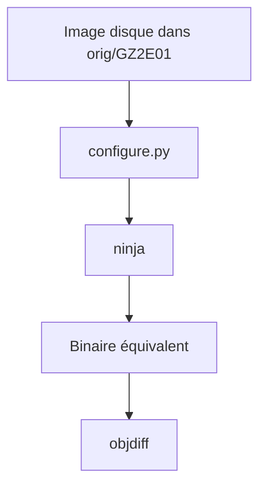

# zeldaret/tp

> Décompilation en cours de Zelda: Twilight Princess, pour retrouver un code source équivalent à l'original.

## Le problème
Le code source d'origine du jeu n'est pas disponible, ce qui empêche de l'étudier, de le corriger ou de l'adapter.

## Ce que ça fait vraiment
Reconstruit du code C/C++ qui, recompilé, redonne un binaire identique à l'original. Le code des versions GameCube est complètement équivalent, mais toutes les unités de traduction ne sont pas encore liées ; on aligne la version debug et les versions Wii. Une même base de code, compilation conditionnelle. Le dépôt ne contient aucun actif ni assembleur du jeu.

## Comment c'est branché
Schéma simplifié d'après la fiche, sans diagramme fourni.


## Essayer
```bash
git clone https://github.com/zeldaret/tp.git
python configure.py
ninja
```

## Coût et pièges
Gratuit, mais il faut posséder une copie du jeu (image disque dans `orig/GZ2E01`). Exige git, ninja et Python 3 ; sous Windows, préférer les outils natifs plutôt que WSL.

## Ce que ce n'est pas
Pas un portage PC et il n'en produira pas. Il ne contient aucun actif du jeu.

## Alternatives
Aucune alternative nommée dans le README (objdiff est cité comme outil de comparaison).

## Pour toi
À ignorer : projet de rétro-ingénierie de jeu vidéo, sans valeur pour ton travail data/IA/MLOps.

