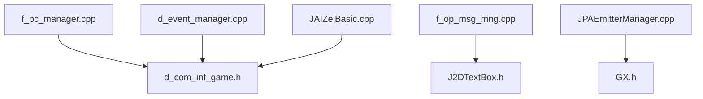

# zeldaret/tww

> Ongoing decompilation of The Legend of Zelda: The Wind Waker (GameCube), for reverse-engineering enthusiasts.

## The problem
The game's source code is not public: understanding or modifying it requires reading assembly.

## What it actually does
Rebuilds C++ code that, once compiled, matches the original binary, tracked by objdiff. The repository contains no assets or assembly: you must supply your own disc image. It covers the process manager, events, messages, audio, particles and graphics layers. A shared Ghidra helps understand the functions.

## How it is wired


## Trying it
```bash
git clone https://github.com/zeldaret/tww.git
python configure.py
ninja
```
First copy the game image into `orig/GZLE01`.

## Cost and gotchas
Free, but you must own the game. Python and ninja are required. PRs generated by AI or copied from Ghidra are rejected.

## What it is not
Not a playable game or a port: it does not contain the resources.

## Alternatives
No alternative named in the README.

## For you
Ignore: game reverse-engineering project, with no use for a data / AI / MLOps profile.
