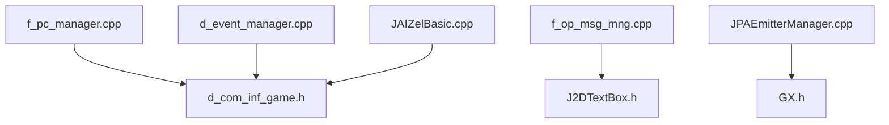

# zeldaret/tww

> Décompilation en cours de The Legend of Zelda: The Wind Waker (GameCube), pour passionnés de rétro-ingénierie.

## Le problème
Le code source du jeu n'est pas public : le comprendre ou le modifier exige de lire de l'assembleur.

## Ce que ça fait vraiment
Reconstruit du code C++ qui, une fois compilé, correspond au binaire d'origine, suivi par objdiff. Le dépôt ne contient aucun asset ni assembleur : il faut fournir sa propre image disque. Il couvre le gestionnaire de processus, les événements, les messages, l'audio, les particules et les couches graphiques. Une Ghidra partagée aide à comprendre les fonctions.

## Comment c'est branché


## Essayer
```bash
git clone https://github.com/zeldaret/tww.git
python configure.py
ninja
```
Copier d'abord l'image du jeu dans `orig/GZLE01`.

## Coût et pièges
Gratuit, mais il faut posséder le jeu. Python et ninja requis. Les PR générées par IA ou copiées de Ghidra sont refusées.

## Ce que ce n'est pas
Pas un jeu jouable ni un port : il ne contient pas les ressources.

## Alternatives
Aucune alternative nommée dans le README.

## Pour toi
Ignorer : projet de rétro-ingénierie de jeu, sans application pour un profil data / IA / MLOps.

