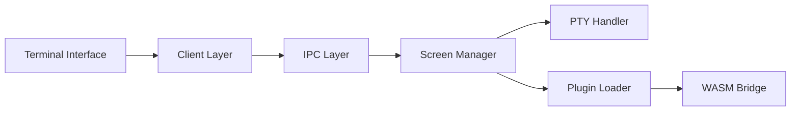

# zellij-org/zellij

> Terminal multiplexer for developers, with WebAssembly plugins, layouts and a built-in web client.

## The problem
Managing several terminal sessions and panes in a scriptable, shareable way, without painful configuration.

## What it actually does
A client and a server communicate over IPC; the server manages screens, panes, PTYs, sessions and layouts. Floating and stacked panes, multi-user collaboration, plugins in any language compiled to WebAssembly, themes. A web client makes the terminal optional.

## How it is wired


## Trying it
```bash
cargo install --locked zellij
bash <(curl -L https://zellij.dev/launch)
cargo xtask run
cargo xtask test
```

## Cost and gotchas
Free. Installing from `main` is not recommended (it can corrupt the cache of released versions). Many open issues (nearly 1,900), which are not all bugs, the README notes.

## What it is not
Not a shell, nor a terminal: it runs inside an existing terminal (or the web client).

## Alternatives
No alternative named in the README ("terminal multiplexers" are mentioned in general).

## For you
Worth watching if you work a lot over SSH on GPU machines: persistent sessions and reproducible layouts.
