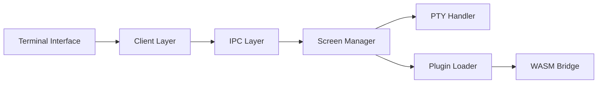

# zellij-org/zellij

> Multiplexeur de terminal pour développeurs, avec plugins WebAssembly, layouts et client web intégré.

## Le problème
Gérer plusieurs sessions et panneaux de terminal, de façon scriptable et partageable, sans configuration pénible.

## Ce que ça fait vraiment
Un client et un serveur communiquent par IPC ; le serveur gère écrans, panneaux, PTY, sessions et layouts. Panneaux flottants et empilés, collaboration multi-utilisateur, plugins en n'importe quel langage compilé en WebAssembly, thèmes. Un client web rend le terminal optionnel.

## Comment c'est branché


## Essayer
```bash
cargo install --locked zellij
bash <(curl -L https://zellij.dev/launch)
cargo xtask run
cargo xtask test
```

## Coût et pièges
Gratuit. L'installation depuis `main` n'est pas recommandée (peut corrompre le cache des versions publiées). Beaucoup d'issues ouvertes (près de 1 900), qui ne sont pas toutes des bugs, précise le README.

## Ce que ce n'est pas
Pas un shell, ni un terminal : il tourne dans un terminal existant (ou le client web).

## Alternatives
Aucune alternative nommée dans le README (« terminal multiplexers » cités en général).

## Pour toi
À surveiller si tu travailles beaucoup en SSH sur des machines GPU : sessions persistantes et layouts reproductibles.

