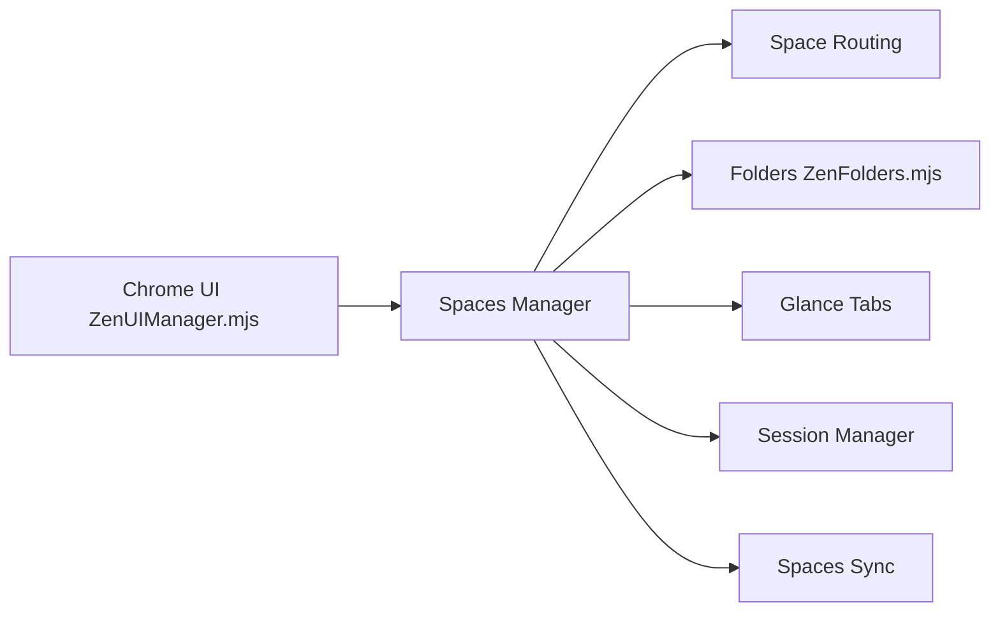

# zen-browser/desktop

> Firefox-based browser for organizing tabs and workspaces, for desktop users.

## The problem
Many tabs open at the same time: the README does not detail the problem, only the productivity goal.

## What it actually does
Minimal README (under 800 characters): browser based on Firefox, with Release (Firefox 156.0) and Twilight versions. From the architecture described: Spaces and routing, pinned tabs, folders, split views, Glance, library, site boosts, live folders, session management, per-space bookmarks, sync and sharing.

## How it is wired


## Trying it
```bash
# Aucune commande documentée : téléchargement depuis le site du projet
```

## Cost and gotchas
Free. MPL-2.0 license (file-level copyleft). Installation and privacy details are outside the README.

## What it is not
Not an independent browsing engine: it follows Firefox versions. The README says nothing more.

## Alternatives
- No alternative named in the README.

## For you
Ignore: a comfort browser has no place in a data/AI/MLOps workflow, and the README material is too thin to argue otherwise.
