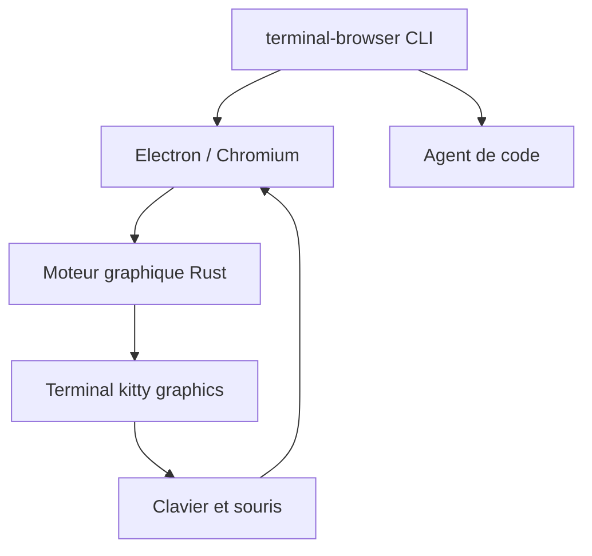

# zenbu-labs/terminal-browser

> A Chromium browser displayed in the terminal, to share the web with a coding agent.

## The problem
A coding agent and a website live in separate windows. Previewing a remote site or handing it to the agent requires back-and-forth.

## What it actually does
Displays Chromium's pixels (Electron's offscreen rendering) in a terminal compatible with the kitty graphics protocol. It relays keyboard and mouse, opens a pane next to the agent and exposes an `action` CLI compatible with agent-browser. The `--ssh` option routes network requests through a remote machine.

## How it is wired


## Trying it
```bash
curl -fsSL https://terminal-browser.sh/install | bash
terminal-browser open <url>
terminal-browser --split right
terminal-browser open --ssh <user@host> <url>
```

## Cost and gotchas
Free. On Windows, WSL and a compatible terminal are required. Usage telemetry and crash reports are enabled by default, and can be disabled with `DO_NOT_TRACK=1`.

## What it is not
It is not a text browser: it renders real pages in pixels. It requires a terminal that supports the kitty graphics protocol.

## Alternatives
No alternative named in the README, apart from awrit, credited in the acknowledgements as a first attempt.

## For you
Watch: interesting for looping a coding agent onto a browser in the same tab, but the project is young, maintained by a single person and collects telemetry.
