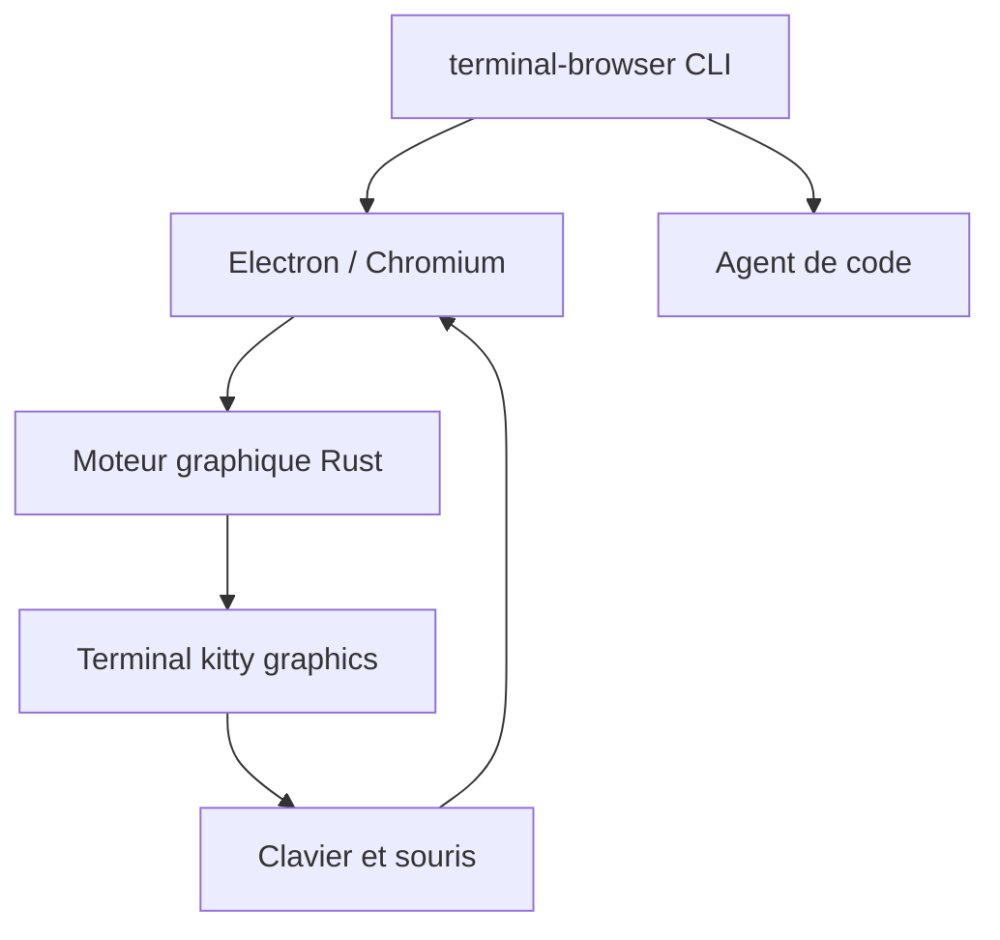

# zenbu-labs/terminal-browser

> Un navigateur Chromium affiché dans le terminal, pour partager le web avec un agent de code.

## Le problème
Un agent de code et un site web vivent dans des fenêtres séparées. Prévisualiser un site distant ou le donner à l'agent demande des allers-retours.

## Ce que ça fait vraiment
Affiche les pixels de Chromium (rendu hors écran d'Electron) dans un terminal compatible avec le protocole graphique kitty. Il relaie clavier et souris, ouvre un volet à côté de l'agent et expose une CLI `action` compatible agent-browser. L'option `--ssh` fait passer les requêtes réseau par une machine distante.

## Comment c'est branché


## Essayer
```bash
curl -fsSL https://terminal-browser.sh/install | bash
terminal-browser open <url>
terminal-browser --split right
terminal-browser open --ssh <user@host> <url>
```

## Coût et pièges
Gratuit. Sous Windows, il faut WSL et un terminal compatible. La télémétrie d'usage et les rapports de crash sont actifs par défaut, désactivables par `DO_NOT_TRACK=1`.

## Ce que ce n'est pas
Ce n'est pas un navigateur de texte : il rend de vraies pages en pixels. Il exige un terminal gérant le protocole graphique kitty.

## Alternatives
Aucune alternative nommée dans le README, hormis awrit cité en remerciements comme première tentative.

## Pour toi
Surveiller : intéressant pour boucler un agent de code sur un navigateur dans le même onglet, mais le projet est jeune, tenu par une seule personne et collecte de la télémétrie.

