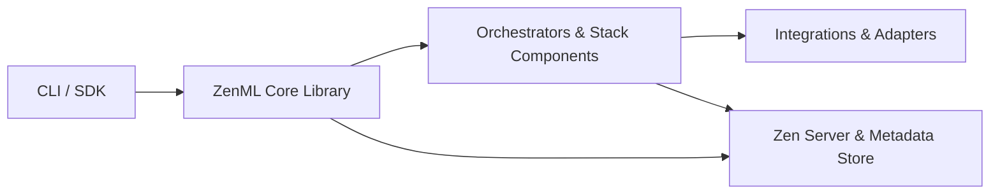

# zenml-io/zenml

> MLOps framework that runs ML pipelines and agents on any infrastructure, for enterprise ML engineers.

## The problem
ML and LLM workflows are hard to reproduce, track and deploy from one environment to another.

## What it actually does
You write Python pipelines and steps with `@pipeline` and `@step`. ZenML containerizes them, tracks each run (metrics, logs, metadata, artifacts) and sends them to a "stack": orchestrator, artifact store, integrations (MLflow, SageMaker, Vertex, LangGraph, Langfuse). A server with a dashboard centralizes the metadata.

## How it is wired


## Trying it
```bash
pip install "zenml[server]"
zenml init
zenml login
```

## Cost and gotchas
Free in open source. A remote server is needed in production; the infrastructure (Kubernetes, object storage) remains your responsibility. The lightweight client installs with `pip install zenml`.

## What it is not
It is not an LLM observability tool like Langfuse nor a simple experiment tracker like MLflow: it orchestrates the full cycle. For agents, the README points to the sister project Kitaru.

## Alternatives
- MLflow: experiment tracking only.
- Langfuse / LangSmith: observability of LLM applications.
- Kitaru: replay-based evaluation for agents.

## For you
Adopt it if you are industrializing ML and LLM pipelines: an old project (2020), active, Apache-2.0, that integrates with what you already use.
