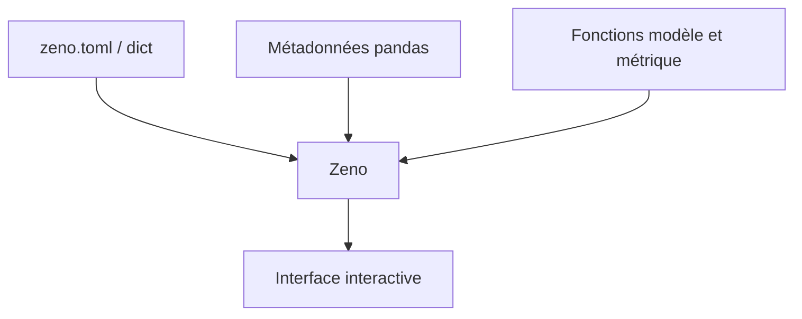

# zeno-ml/zeno

> ML model evaluation framework with a Python API and an interactive interface; replaced by ZenoHub.

## The problem
Global metrics hide where a model fails; you need to explore performance by data slice.

## What it actually does
A Python API and an interface let you explore results on images, audio, text or sensor data. Configuration through `zeno.toml` or a dictionary from Jupyter. Demos are hosted on Hugging Face.

## How it is wired
Simplified diagram based on the sheet, no diagram provided.


## Trying it
```bash
pip install zenoml
zeno init
zeno zeno.toml
```

## Cost and gotchas
Free. Archived, last push in October 2023: risk of incompatibility with recent versions.

## What it is not
Not a training tool: it evaluates existing models. No longer maintained.

## Alternatives
ZenoHub: the replacement cited in the README.

## For you
Ignore: the idea of slice-based evaluation is useful, but the tool is archived; look at ZenoHub.
