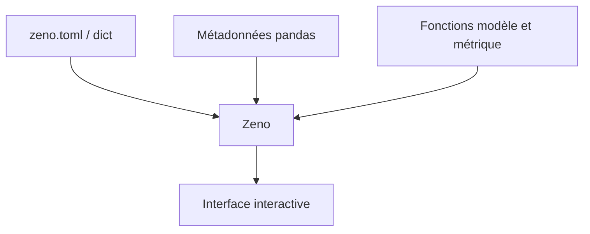

# zeno-ml/zeno

> Cadre d'évaluation de modèles ML avec API Python et interface interactive ; remplacé par ZenoHub.

## Le problème
Les métriques globales cachent où un modèle échoue ; il faut explorer les performances par tranche de données.

## Ce que ça fait vraiment
Une API Python et une interface permettent d'explorer les résultats sur images, audio, texte ou capteurs. Configuration par `zeno.toml` ou dictionnaire depuis Jupyter. Des démos sont hébergées sur Hugging Face.

## Comment c'est branché
Schéma simplifié d'après la fiche, sans diagramme fourni.


## Essayer
```bash
pip install zenoml
zeno init
zeno zeno.toml
```

## Coût et pièges
Gratuit. Archivé, dernier push en octobre 2023 : risque d'incompatibilité avec les versions récentes.

## Ce que ce n'est pas
Pas un outil d'entraînement : il évalue des modèles existants. Plus maintenu.

## Alternatives
ZenoHub : remplaçant cité dans le README.

## Pour toi
À ignorer : l'idée d'évaluation par tranche est utile, mais l'outil est archivé ; regarde ZenoHub.

