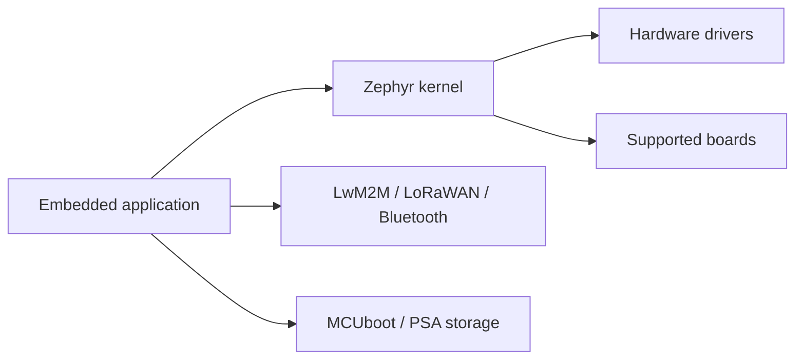

# zephyrproject-rtos/zephyr

> Real-time operating system for microcontrollers, multi-architecture, for embedded developers.

## The problem
Small constrained devices (sensors, connected objects) need a lightweight, secure kernel that is portable across many boards.

## What it actually does
Small-footprint kernel for ARM (Cortex-A/R/M), x86, ARC, Xtensa, RISC-V, SPARC, MIPS and many boards. Drivers (NVMe, PCIe, I2C), connectivity (LwM2M, LoRaWAN, Bluetooth), services (firmware update, PSA protected storage, MCUboot, MCTP).

## How it is wired

## Trying it
No command in the README; refers to the Getting Started Guide on docs.zephyrproject.org.

## Cost and gotchas
Free; target hardware and a cross-compilation toolchain required (not detailed in the README).

## What it is not
Not an embedded Linux: it is an RTOS for very constrained devices.

## Alternatives
No alternative named in the README.

## For you
Ignore: useful for TinyML on microcontrollers only if you do embedded work; otherwise out of scope.
