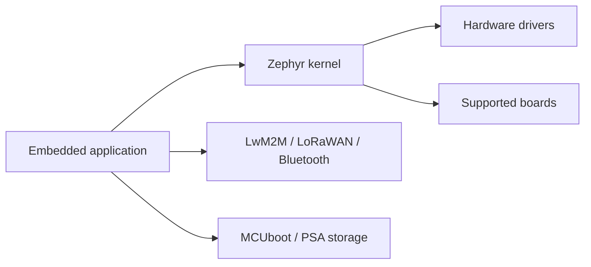

# zephyrproject-rtos/zephyr

> Système d'exploitation temps réel pour microcontrôleurs, multi-architectures, pour développeurs embarqués.

## Le problème
Les petits appareils contraints (capteurs, objets connectés) ont besoin d'un noyau léger, sécurisé et portable entre de nombreuses cartes.

## Ce que ça fait vraiment
Noyau à petite empreinte pour ARM (Cortex-A/R/M), x86, ARC, Xtensa, RISC-V, SPARC, MIPS et de nombreuses cartes. Pilotes (NVMe, PCIe, I2C), connectivité (LwM2M, LoRaWAN, Bluetooth), services (mise à jour de firmware, stockage protégé PSA, MCUboot, MCTP).

## Comment c'est branché

## Essayer
Aucune commande dans le README ; renvoi au Getting Started Guide sur docs.zephyrproject.org.

## Coût et pièges
Gratuit ; matériel cible et chaîne de compilation croisée requis (non détaillés dans le README).

## Ce que ce n'est pas
Pas un Linux embarqué : c'est un RTOS pour appareils très contraints.

## Alternatives
Aucune alternative nommée dans le README.

## Pour toi
À ignorer : utile pour le TinyML sur microcontrôleur seulement si tu fais de l'embarqué ; sinon hors périmètre.

