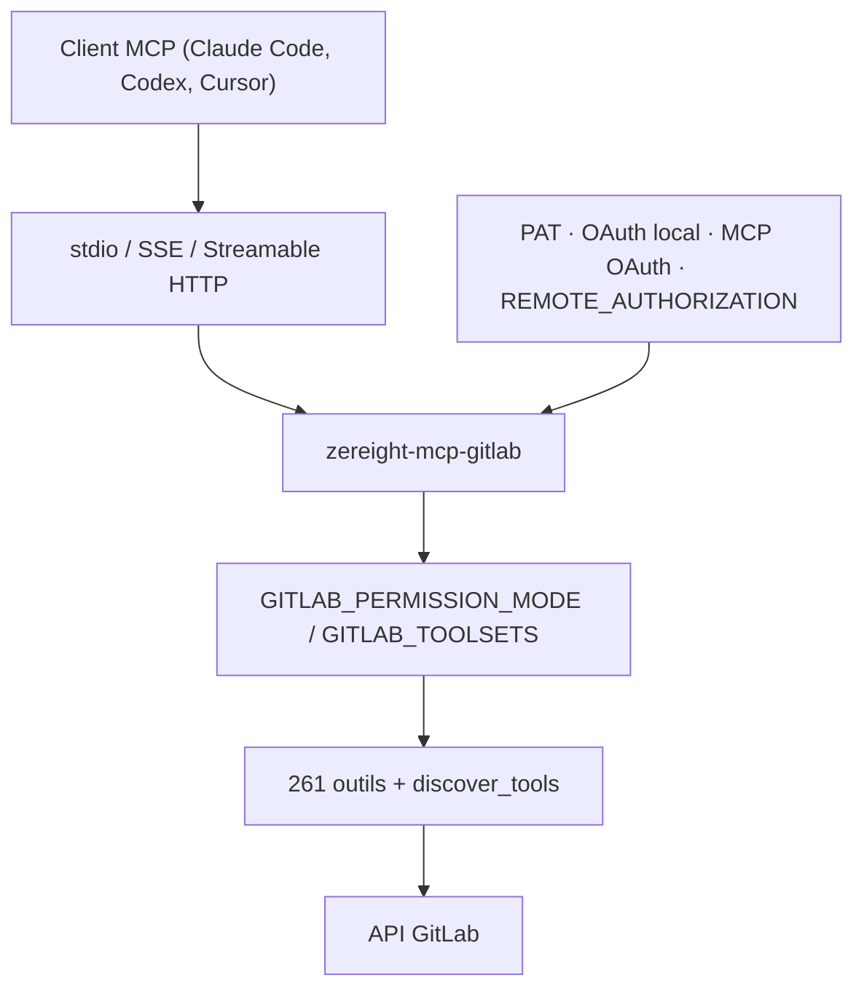

# zereight/gitlab-mcp

> GitLab MCP server with 261 tools, optimized for agent workflows.

## The problem
An agent that has to review a merge request, follow a pipeline or sort a GitLab issue has no structured access: the API calls have to be written by hand.

## What it actually does
Covers projects, merge requests, issues, pipelines, wiki, releases, tags, milestones. The design choice is the opposite of grouping: 261 granular tools plus a `discover_tools` that activates batches at runtime, so as to start with a small context. MR review is done in two steps — `list_merge_request_changed_files` then batched `get_merge_request_file_diff` calls. Four authentication methods: personal token, OAuth2 in a local browser, MCP OAuth proxy for remote clients like Claude.ai, and remote authorization where each caller supplies its token in a header. Three transports: stdio, SSE, Streamable HTTP. Fine-grained filtering via `GITLAB_PERMISSION_MODE` (`readonly`, `modify` without deletion, `full`), by toolsets, by tool allowlist or by deny regex. An Agent Skill is bundled in `skills/gitlab-mcp/`.

## How it is wired


## Trying it
```bash
brew tap zereight/gitlab-mcp https://github.com/zereight/gitlab-mcp
brew install zereight/gitlab-mcp/zereight-mcp-gitlab
npm install -g @zereight/mcp-gitlab
npx -y @zereight/mcp-gitlab@2.1.63
zereight-mcp-gitlab auth
docker run -i --rm -e HOST=0.0.0.0 -e STREAMABLE_HTTP=true -e REMOTE_AUTHORIZATION=true -p 3333:3002 zereight050/gitlab-mcp
```

## Cost and gotchas
MIT, Node ≥ 18.17. Remote deployment is the delicate topic: `GITLAB_OAUTH_REDIRECT_URI` only concerns local OAuth, and fixing a remote `Unregistered redirect_uri` goes through `GITLAB_OAUTH_CALLBACK_PROXY=true`, not through that variable — the README insists on this. MCP OAuth mode requires a pre-registered GitLab OAuth application, because GitLab restricts dynamically registered applications to the `mcp` scope, which is insufficient. `REMOTE_AUTHORIZATION` is incompatible with SSE. Default limits: 60 requests/minute, 1000 sessions, tokens expired after one hour of inactivity.

## What it is not
It is not a GitLab client with an interface: it is an MCP server. Nor is it a risk-free tool — in `full` mode it deletes, including via `execute_graphql` and the `delete`/`move` actions of `push_files`, hence the existence of the `modify` mode.

## Alternatives
- The community CQRS-style "GitLab MCP A", compared in the README: 50-60 grouped tools, designed for enterprise multi-instance, often Node ≥ 24.

## For you
The right choice if your code lives on GitLab and you want an agent that reviews MRs seriously.
