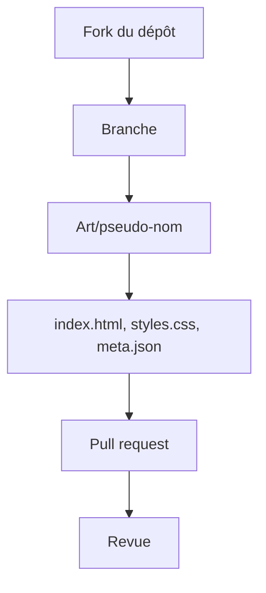

# zero-to-mastery/Animation-Nation

> Collaborative gallery of animations in pure HTML and CSS, for beginners practicing GitHub contributions.

## The problem
Beginners look for a simple playground to practice contributing to open source.

## What it actually does
Each contributor adds a folder in `Art/` with `index.html`, `styles.css` and `meta.json` (artwork name, GitHub username). The animation must loop without interaction, without JavaScript, images or SVG. The repository is an exercise in the pull request workflow.

## How it is wired
Simplified diagram based on the sheet, no diagram provided.


## Trying it
```bash
git clone https://github.com/<your-github-username>/Animation-Nation.git
```

## Cost and gotchas
Free. Inactive PRs may be marked `stale` or closed; no other file must be modified. License not declared.

## What it is not
It is not a reusable animation library: the artworks are isolated demonstrations.

## Alternatives
No alternative named in the README.

## For you
Ignore: beginner CSS exercise, unrelated to your data / AI work.
