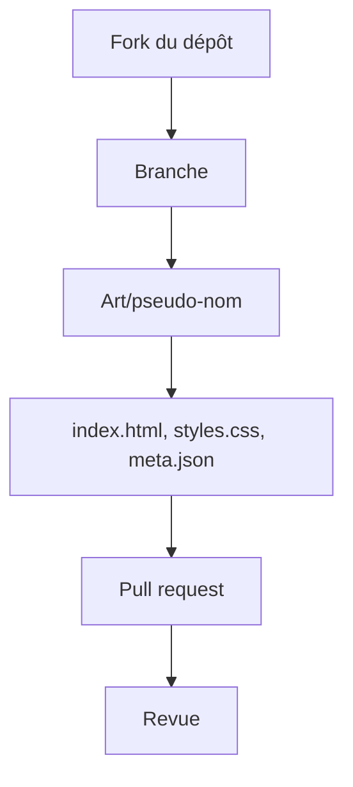

# zero-to-mastery/Animation-Nation

> Galerie collaborative d'animations en HTML et CSS seuls, pour débutants qui s'exercent aux contributions GitHub.

## Le problème
Les débutants cherchent un terrain simple pour s'exercer à contribuer en open source.

## Ce que ça fait vraiment
Chaque contributeur ajoute un dossier dans `Art/` avec `index.html`, `styles.css` et `meta.json` (nom de l'œuvre, pseudo GitHub). L'animation doit boucler sans interaction, sans JavaScript, image ou SVG. Le dépôt est un exercice de flux de pull request.

## Comment c'est branché
Schéma simplifié d'après la fiche, sans diagramme fourni.


## Essayer
```bash
git clone https://github.com/<your-github-username>/Animation-Nation.git
```

## Coût et pièges
Gratuit. Les PR inactives peuvent être marquées `stale` ou fermées ; aucun autre fichier ne doit être modifié. Licence non déclarée.

## Ce que ce n'est pas
Ce n'est pas une bibliothèque réutilisable d'animations : les œuvres sont des démonstrations isolées.

## Alternatives
Aucune alternative nommée dans le README.

## Pour toi
À ignorer : exercice pour débutants en CSS, sans rapport avec ton travail data / IA.

