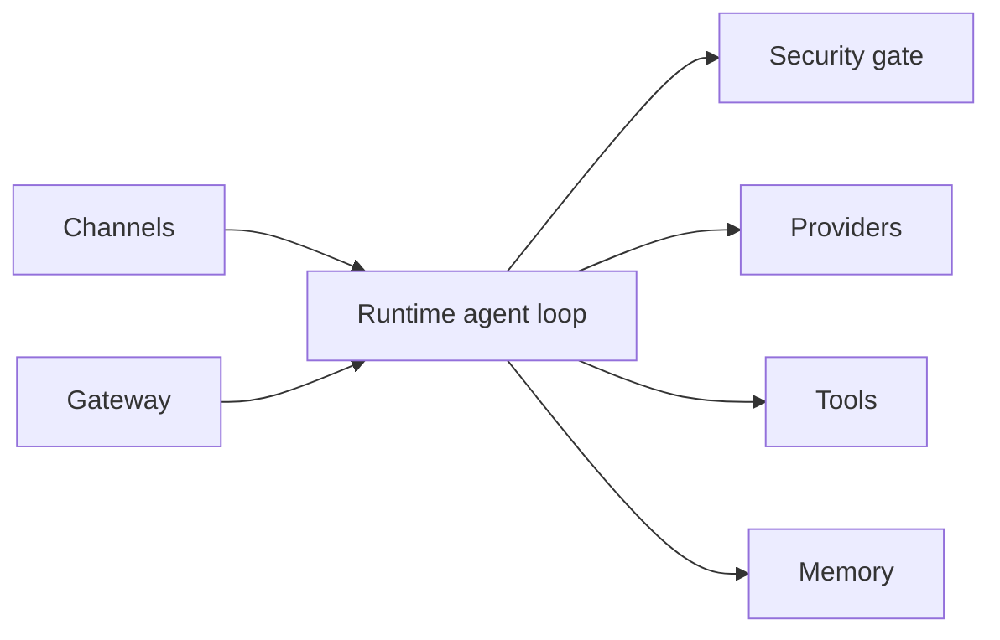

# zeroclaw-labs/zeroclaw

> Personal AI agent runtime in a single Rust binary, wired to 30+ messaging channels, for those who want to host everything.

## The problem
AI assistants run at a third party; an always-on agent, reachable everywhere and under your control, is uncommon.

## What it actually does
A binary configured by a TOML file: it talks to ~20 LLM providers, receives messages (Discord, Telegram, Matrix, email, voice, webhooks, CLI) and acts through tools (shell, browser, HTTP, hardware, MCP). Autonomy is `supervised` by default, with OS sandboxes and cryptographic receipts of actions. SQLite/Postgres/Qdrant memory, a procedures engine (SOP), an HTTP/WebSocket gateway with a dashboard, WASM plugins, GPIO on Raspberry Pi, ESP32…

## How it is wired


## Trying it
```bash
curl -fsSL https://raw.githubusercontent.com/zeroclaw-labs/zeroclaw/master/install.sh | sh
zeroclaw quickstart
zeroclaw agent -a <alias>
zeroclaw service install
zeroclaw service start
```

## Cost and gotchas
Provider keys or subscription are at your expense. YOLO mode turns off the safeguards. Beware of repositories impersonating the name (warning in the README). 1,045 open issues.

## What it is not
Not a turnkey chatbot: it is a runtime to configure, with shell access and potentially hardware access. The security guarantees are described, not audited here.

## Alternatives
No alternative named in the README.

## For you
Worth watching: interesting for a self-hosted multi-channel assistant, but the tool is young (created in 2026) and very broad; test in supervised mode before entrusting it with real actions.
