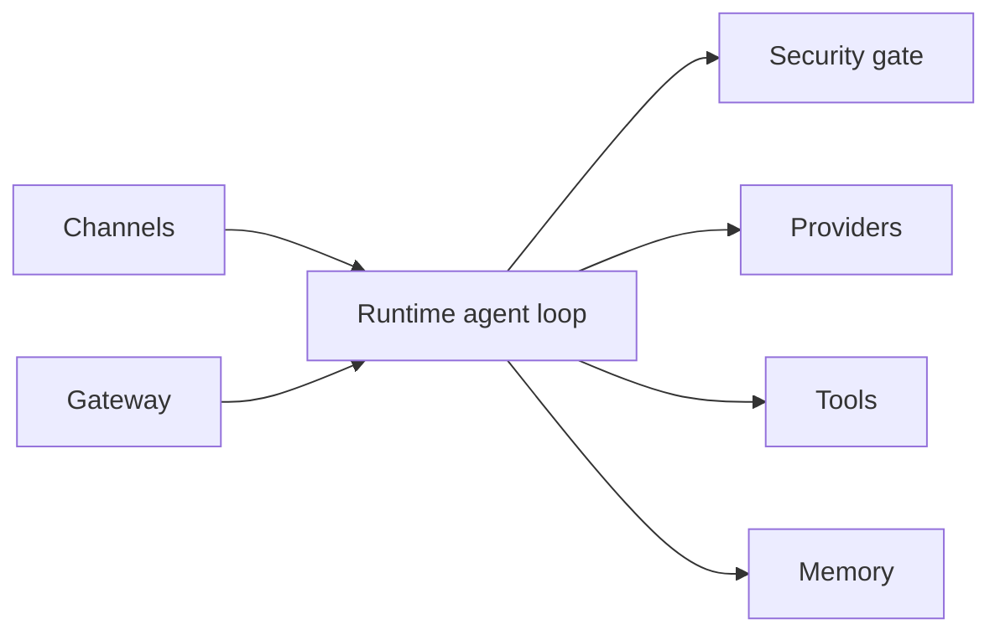

# zeroclaw-labs/zeroclaw

> Runtime d'agent IA personnel en un binaire Rust, branché sur 30+ canaux de messagerie, pour qui veut tout héberger.

## Le problème
Les assistants IA tournent chez un tiers ; un agent toujours actif, joignable partout et sous ton contrôle est peu courant.

## Ce que ça fait vraiment
Un binaire configuré par un fichier TOML : il parle à ~20 fournisseurs LLM, reçoit des messages (Discord, Telegram, Matrix, email, voix, webhooks, CLI) et agit par outils (shell, navigateur, HTTP, matériel, MCP). Autonomie `supervised` par défaut, sandboxes OS, reçus cryptographiques des actions. Mémoire SQLite/Postgres/Qdrant, moteur de procédures (SOP), passerelle HTTP/WebSocket avec tableau de bord, plugins WASM, GPIO sur Raspberry Pi, ESP32…

## Comment c'est branché


## Essayer
```bash
curl -fsSL https://raw.githubusercontent.com/zeroclaw-labs/zeroclaw/master/install.sh | sh
zeroclaw quickstart
zeroclaw agent -a <alias>
zeroclaw service install
zeroclaw service start
```

## Coût et pièges
Clés ou abonnement du fournisseur à ta charge. Le mode YOLO coupe les garde-fous. Attention aux dépôts usurpant le nom (avertissement du README). 1 045 issues ouvertes.

## Ce que ce n'est pas
Pas un chatbot clé en main : c'est un runtime à configurer, avec accès shell et matériel potentiel. Les garanties de sécurité sont décrites, non auditées ici.

## Alternatives
Aucune alternative nommée dans le README.

## Pour toi
À surveiller : intéressant pour un assistant auto-hébergé multi-canaux, mais l'outil est jeune (créé en 2026) et très large ; teste en mode supervisé avant de lui confier des actions réelles.

