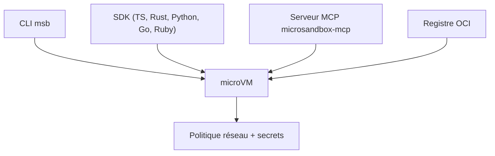

# zerocore-ai/microsandbox

> Runs untrusted code (AI agents, plugins, CI) in local microVMs, with a CLI and SDKs.

## The problem
Running agent-generated code on your machine is risky, and containers share the host kernel.

## What it actually does
Starts hardware-isolated microVMs (under 100 ms claimed), from OCI images. Fork and snapshot of live sandboxes. Secrets that never enter the VM. Embeddable without a daemon, via TypeScript, Rust, Python, Go, Ruby SDKs. MCP server and Agent Skills for agents.

## How it is wired

Diagram inferred from the README; no diagram provided.

## Trying it
```sh
curl -fsSL https://install.microsandbox.dev | sh
msb run ubuntu
msb run python -- python3 -c "print('Hello from a microVM!')"
msb create --name app python
msb exec app -- python -c "import this"
msb fork app --name app2
```

## Cost and gotchas
Linux: KVM required; macOS: Apple Silicon; Windows: WHP. First launch: download of the image and runtime.

## What it is not
Beta software: breaking changes expected. Not a container orchestrator.

## Alternatives
No alternative named in the README.

## For you
Adopt: simple local sandbox to run agent code or untrusted notebooks, worth testing despite the beta.
