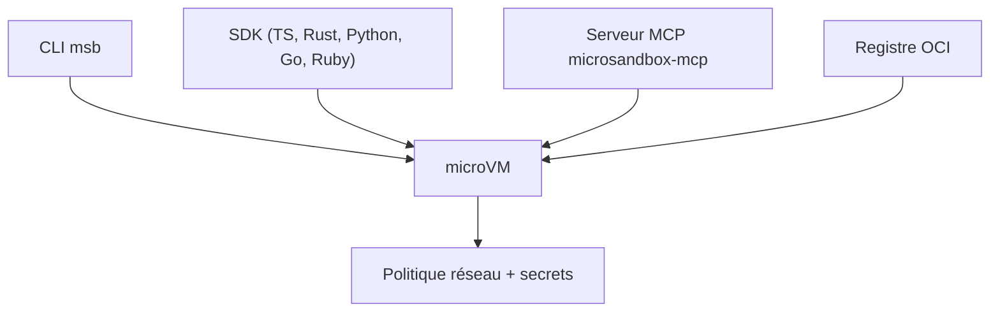

# zerocore-ai/microsandbox

> Exécute du code non fiable (agents IA, plugins, CI) dans des microVM locales, avec CLI et SDK.

## Le problème
Lancer du code généré par un agent sur ta machine est risqué, et les conteneurs partagent le noyau de l'hôte.

## Ce que ça fait vraiment
Démarre des microVM isolées matériellement (moins de 100 ms annoncé), à partir d'images OCI. Fork et snapshot de sandboxes vivantes. Secrets qui n'entrent jamais dans la VM. Embarquable sans démon, via SDK TypeScript, Rust, Python, Go, Ruby. Serveur MCP et Agent Skills pour agents.

## Comment c'est branché

Schéma déduit du README ; aucun diagramme fourni.

## Essayer
```sh
curl -fsSL https://install.microsandbox.dev | sh
msb run ubuntu
msb run python -- python3 -c "print('Hello from a microVM!')"
msb create --name app python
msb exec app -- python -c "import this"
msb fork app --name app2
```

## Coût et pièges
Linux : KVM requis ; macOS : Apple Silicon ; Windows : WHP. Premier lancement : téléchargement de l'image et du runtime.

## Ce que ce n'est pas
Logiciel en bêta : changements cassants attendus. Pas un orchestrateur de conteneurs.

## Alternatives
Aucune alternative nommée dans le README.

## Pour toi
Adopter : bac à sable local simple pour faire exécuter du code d'agent ou des notebooks non fiables, à tester malgré la bêta.

