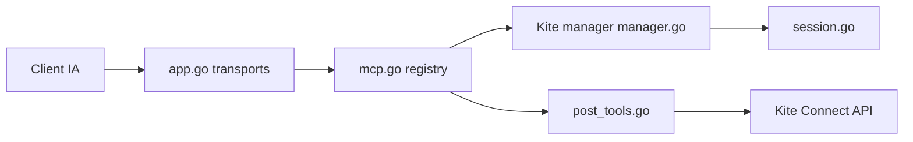

# zerodha/kite-mcp-server

> MCP server giving an AI assistant access to a Zerodha Kite Connect trading account.

## The problem
An assistant cannot view a portfolio or place orders without a standardized interface to the brokerage API.

## What it actually does
Exposes through MCP login, quotes, history, positions, orders (place, modify, cancel), GTT orders and funds. Modes: stdio, HTTP, SSE or hybrid. A hosted version is available at `mcp.kite.trade`, without the destructive trading operations. `EXCLUDED_TOOLS` variable for read-only instances.

## How it is wired


## Trying it
```bash
git clone https://github.com/zerodha/kite-mcp-server
cd kite-mcp-server
go build -o kite-mcp-server
./kite-mcp-server
```

## Cost and gotchas
Self-hosting: Kite Connect keys (brokerage subscription, not specified) and Go 1.21+. Real orders commit actual money: exclude place/modify/cancel when testing.

## What it is not
Not a financial advisor nor a backtesting tool. The hosted instance does not place orders. Reserved for Zerodha customers.

## Alternatives
No alternative cited in the README.

## For you
Worth watching: a clean example of MCP on a brokerage API; enable write access only if you are a Zerodha customer.
