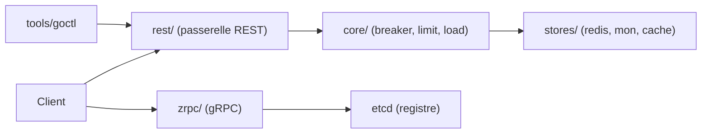

# zeromicro/go-zero

> Go web and RPC framework with goctl code generation, for high-load services.

## The problem
Writing Go microservices forces you to recode timeouts, rate limiting, circuit breakers and project skeletons, and to keep them consistent across services.

## What it actually does
An .api file describes the routes; goctl generates the Go server (handler, logic, svc, types) and clients in several languages. At runtime, the framework adds chained timeout control, concurrency limiting, an adaptive circuit breaker and load shedding. It also covers REST (rest/), gRPC (zrpc/), Redis and MongoDB caches (stores/) and service discovery. The README documents a workflow for AI assistants (ai-context, zero-skills, mcp-zero).

## How it is wired


## Trying it
```bash
go get -u github.com/zeromicro/go-zero
go install github.com/zeromicro/go-zero/tools/goctl@latest
goctl api -o greet.api
goctl api go -api greet.api -dir greet
cd greet
go mod tidy
go run greet.go -f etc/greet-api.yaml
curl -i http://localhost:8888/greet/from/you
```

## Cost and gotchas
Free; Go required. Redis, MongoDB or etcd are only needed for the corresponding modules. The traffic and benchmark figures in the README come from the authors.

## What it is not
It is not a data tool: it is a back-end services foundation. The detailed documentation is mainly outside the README.

## Alternatives
No alternative cited in the README.

## For you
Worth watching: relevant if you write Go inference or API services, otherwise outside the scope of a Python data/AI profile.
