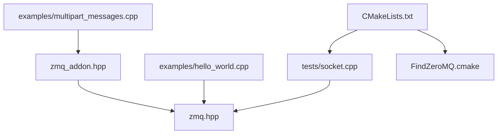

# zeromq/cppzmq

> Header-only C++ binding for libzmq, with type safety and RAII resource management.

## The problem
libzmq's C API uses void* and error codes, which makes C++ code fragile.

## What it actually does
zmq.hpp wraps libzmq's C API in typed classes, with exceptions and RAII. zmq_addon.hpp adds higher-level abstractions such as multipart messages. Just include these headers. Any 4.x version of libzmq should work. CMake finds libzmq via FindZeroMQ.cmake.

## How it is wired


## Trying it
```bash
git clone https://github.com/zeromq/cppzmq.git
cd cppzmq
mkdir build
cd build
cmake ..
sudo make -j4 install
```

## Cost and gotchas
Free. libzmq must be installed, plus a C++11 compiler. Tests require CMake and Catch.

## What it is not
It is not an implementation of ZeroMQ: it only binds libzmq. It is not the highest-level binding.

## Alternatives
- zmqpp: higher-level binding, not header-only.
- czmqpp: binding based on the czmq API.
- fbzmq: integration with Apache Thrift, requires C++14.

## For you
Ignore: only useful if you write C++ with ZeroMQ; in Python, pyzmq is enough.
