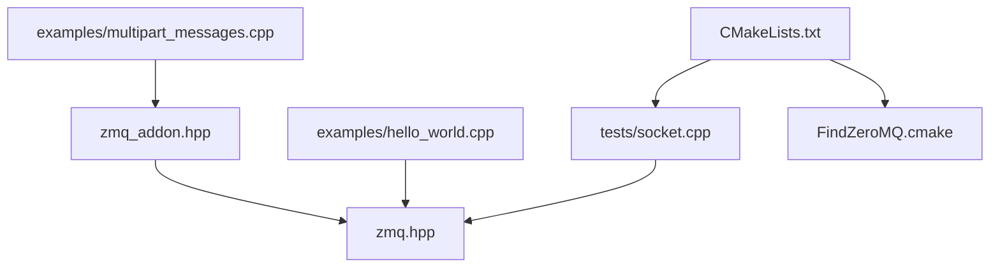

# zeromq/cppzmq

> Liaison C++ en en-têtes seuls pour libzmq, avec types sûrs et gestion des ressources par RAII.

## Le problème
L'API C de libzmq utilise des void* et des codes d'erreur, ce qui rend le code C++ fragile.

## Ce que ça fait vraiment
zmq.hpp reprend l'API C de libzmq en classes typées, avec exceptions et RAII. zmq_addon.hpp ajoute des abstractions de plus haut niveau comme les messages multipart. Il suffit d'inclure ces en-têtes. Toute version 4.x de libzmq doit fonctionner. CMake trouve libzmq via FindZeroMQ.cmake.

## Comment c'est branché


## Essayer
```bash
git clone https://github.com/zeromq/cppzmq.git
cd cppzmq
mkdir build
cd build
cmake ..
sudo make -j4 install
```

## Coût et pièges
Gratuit. Il faut libzmq installé et un compilateur C++11. Les tests demandent CMake et Catch.

## Ce que ce n'est pas
Ce n'est pas une implémentation de ZeroMQ : elle ne fait que lier libzmq. Ce n'est pas la liaison la plus haut niveau.

## Alternatives
- zmqpp : liaison de plus haut niveau, non header-only.
- czmqpp : liaison fondée sur l'API czmq.
- fbzmq : intégration avec Apache Thrift, demande C++14.

## Pour toi
À ignorer : utile seulement si tu écris du C++ avec ZeroMQ ; en Python, pyzmq suffit.

