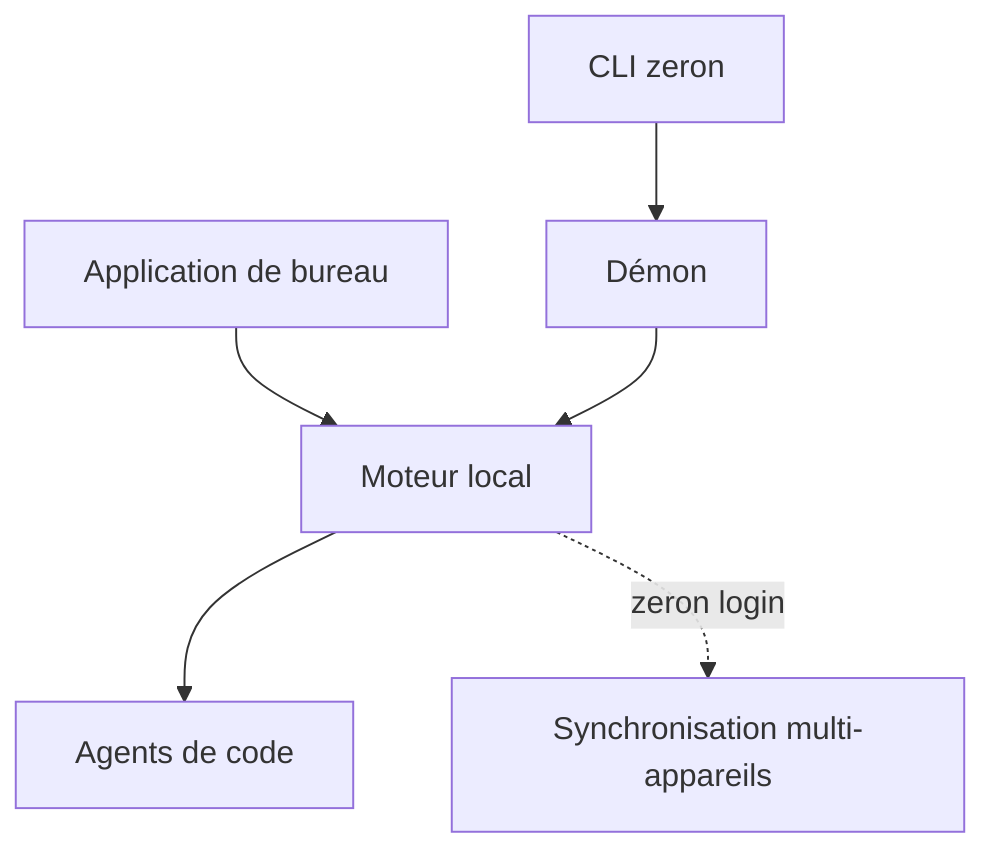

# zeronsh/zeron

> Application that drives your coding agents locally, with optional multi-device synchronization.

## The problem
Several coding agents run on several machines, with no single view to track them or resume them remotely.

## What it actually does
Desktop application (macOS, Windows, Linux) or headless daemon (Linux) to control Claude Code, Codex, Cursor, Devin, Grok, Hermes, Pi and Antigravity. Sessions stay on the device by default. An optional connection lets you follow an agent from another device.

## How it is wired
Simplified diagram based on the sheet, no diagram provided.



## Trying it
```bash
curl -fsSL https://zeron.sh/install.sh | sh
zeron status
zeron daemon start
zeron login
```

## Cost and gotchas
Free; synchronization requires an account. Devices on the same account read and write each other's working files: only connect trusted machines. The script runs via `curl | sh`.

## What it is not
Not an agent: it orchestrates them. Short README (under 800 useful characters), internal workings undocumented.

## Alternatives
No alternative named in the README.

## For you
Worth watching: useful if you run several agents on a VPS, but the README says nothing about the architecture or the security model.
