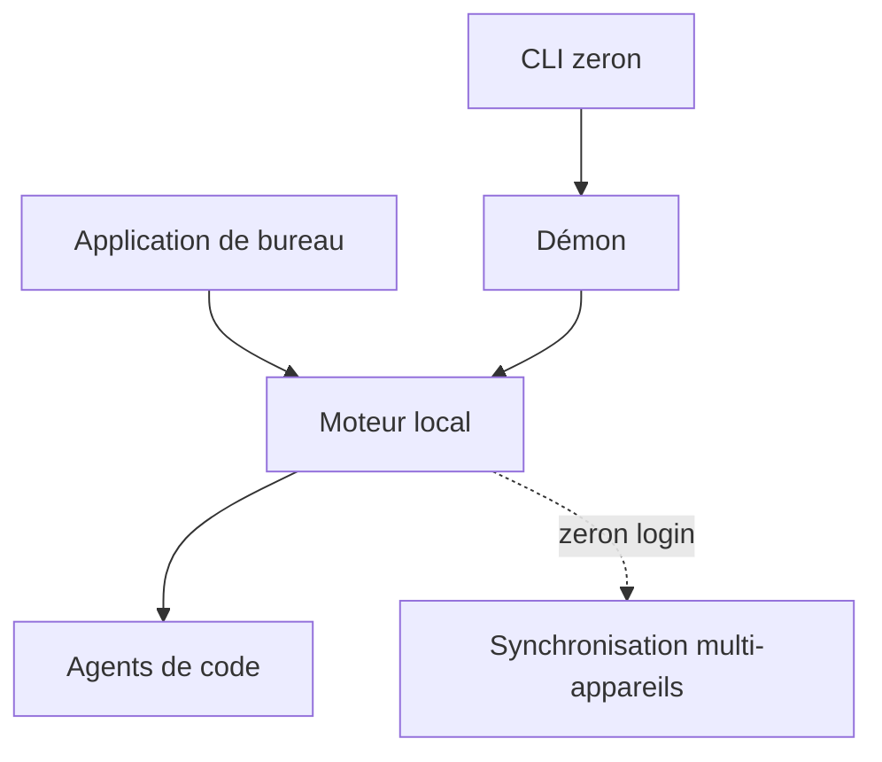

# zeronsh/zeron

> Application qui pilote vos agents de code en local, avec synchronisation multi-appareils facultative.

## Le problème
Plusieurs agents de code tournent sur plusieurs machines, sans vue unique pour les suivre ou les reprendre à distance.

## Ce que ça fait vraiment
Application de bureau (macOS, Windows, Linux) ou démon sans écran (Linux) pour contrôler Claude Code, Codex, Cursor, Devin, Grok, Hermes, Pi et Antigravity. Les sessions restent sur l'appareil par défaut. Une connexion facultative permet de suivre un agent depuis un autre appareil.

## Comment c'est branché
Schéma simplifié d'après la fiche, sans diagramme fourni.



## Essayer
```bash
curl -fsSL https://zeron.sh/install.sh | sh
zeron status
zeron daemon start
zeron login
```

## Coût et pièges
Gratuit ; la synchronisation demande un compte. Les appareils d'un même compte lisent et écrivent mutuellement leurs fichiers de travail : ne connectez que des machines de confiance. Le script s'exécute via `curl | sh`.

## Ce que ce n'est pas
Pas un agent : il en orchestre. README court (moins de 800 caractères utiles), fonctionnement interne non documenté.

## Alternatives
Aucune alternative nommée dans le README.

## Pour toi
À surveiller : utile si tu fais tourner plusieurs agents sur un VPS, mais le README ne dit rien de l'architecture ni du modèle de sécurité.

